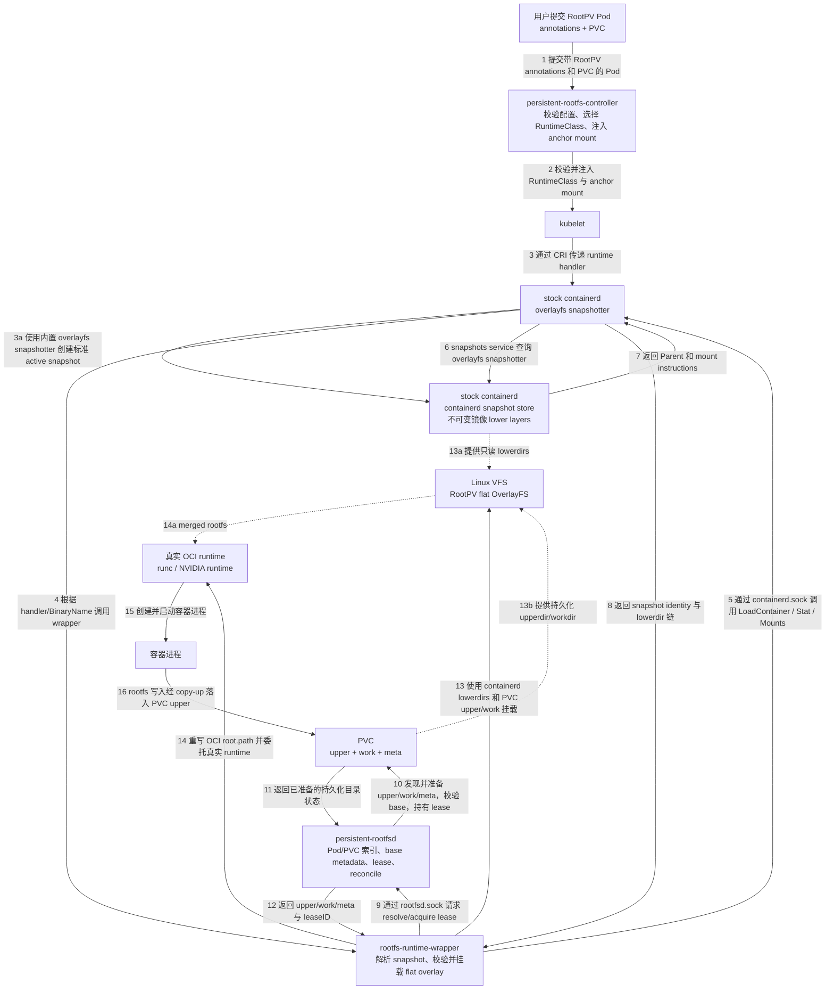
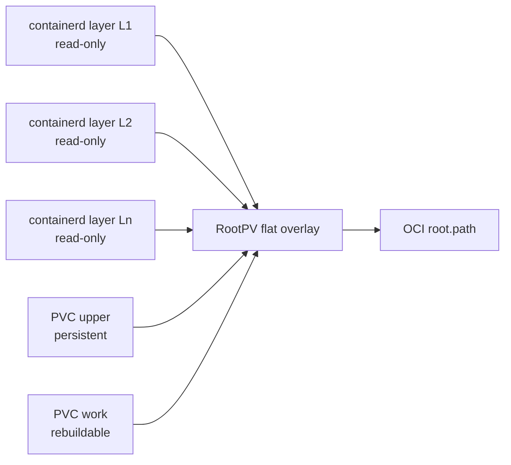
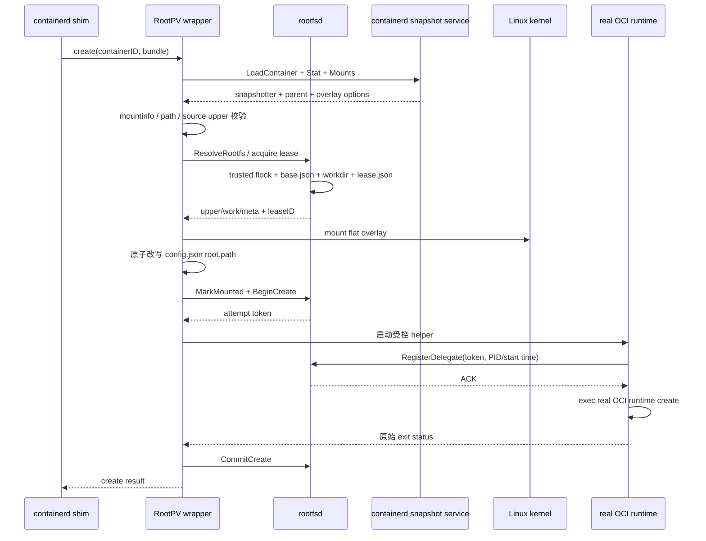
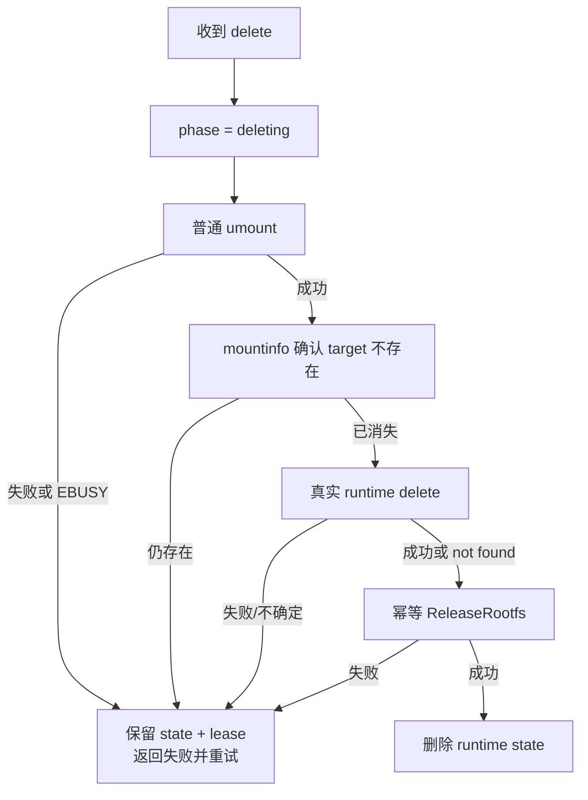

# RootPV 项目方案设计及立项评审

> **2026-10-20 更新：** 已增加 [gVisor runsc adapter](06-gvisor-runsc-runtime-adapter-design.md)。
> io.containerd.runsc.v1 通过 shim TOML 的 binary_name 接入 OCI wrapper，生成配置关闭内部临时 overlay。
> 下文关于旧实现拒绝 gVisor 的叙述保留历史语境；当前能力以新设计和兼容性矩阵为准。

**文档状态：** 已评审

**日期：** 2026-07-13

**目标读者：** TC、Maintainer、其他开发者

**项目定位：** 为 Kubernetes 容器提供可在 Pod 重建时候保留 writable rootfs，同时复用原生containerd 管理的不可变镜像层

> **后续演进（2026-10-14）：** 本文保留 2026-07 的立项评审背景与当时的首发建议，
> 其中“仅 OCI wrapper、人工 adapter、非 runc-v2 全部不支持”的项目范围已部分更新。
> 当前自动发现见 [catalog 设计](03-configmap-driven-runtime-adapter-extension-design.md)，
> Kata + QEMU 已有 [独立 task shim adapter](05-kata-qemu-task-shim-adapter-design.md) 和
> [限定功能验证](../../tests/e2e/results/kata-qemu-2026-10-14.md)。
> CLH/gVisor 等类型仍无对应 adapter；实际验证范围以 [兼容性矩阵](04-compatibility-validation-plan.md) 为准。

## 1. 项目摘要

RootPV 是一个面向 Kubernetes 的节点侧持久化 rootfs 项目。它允许用户将容器 writable rootfs 的变化保存到 PVC，在 Pod 删除、重建或容器运行时重启后继续使用这些变化。

典型变化包括：

- 通过 `apt`、`pip`、`npm` 等工具安装到系统目录的依赖；
- 写入 `/root`、`/usr/local`、`/var/lib`、`/opt`、`/tmp`、`/home` 等目录的数据；
- 对镜像内已有文件的修改；
- 对镜像内已有文件的删除语义；
- OverlayFS copy-up、whiteout 和 opaque directory 元数据。

RootPV 不复制或保存完整展开后的镜像 rootfs。它只持久化 OverlayFS 可写增量层以及少量一致性元数据；镜像的只读层仍由 stock containerd 的 `overlayfs` snapshotter 管理。容器创建时，RootPV 通过 containerd 公开的只读 API 重新解析当前镜像层链，并构造一个单层 OverlayFS：

```text
lowerdir = containerd 管理的只读镜像层链
upperdir = PVC 中的持久化增量层
workdir  = PVC 中的 OverlayFS 工作目录
```

RootPV 通过 OCI runtime wrapper 接入容器创建流程，最终仍把容器委托给 `runc`、NVIDIA Container Runtime 等真实 OCI runtime。项目不要求修改 containerd 源码，不引入 containerd fork，也不接管镜像拉取、解包或 snapshot GC。

## 2. 核心待评审内容

重点评审以下事项：

1. 持久化 writable rootfs 是否是一个适合独立开源项目承载的通用问题。
2. “stock containerd + OCI runtime wrapper + PVC upperdir”是否具有清晰、可维护的组件边界。
3. 以 containerd active snapshot 的 `Parent` 作为不可变 rootfs chain identity 是否合理。
4. RootPV 对 containerd snapshot 生命周期、OCI runtime 生命周期和 Kubernetes volume 生命周期的约束是否充分。
5. 首个社区版本只支持 containerd `overlayfs`、Linux OverlayFS 和 `Strict` base image policy 是否是合适的最小范围。
6. 安全边界、故障恢复、可观测性和后续兼容性 Roadmap 是否足以支撑社区协作。

## 3. 用户场景与问题定义

### 3.1 AI/ML 开发环境

模型开发者经常在运行中的容器内安装 Python 包、系统工具、编译器、CUDA 辅助库或调试工具。部分依赖会同时修改 `/usr`、`/etc`、`/var`、`/root` 等多个系统目录，难以通过一个普通 data volume 完整承载。

如果 Pod 被驱逐或重建，默认容器 writable layer 会随 containerd active snapshot 一起删除，用户需要重新安装环境。RootPV 让这类开发环境保留可写根文件系统增量，同时继续使用镜像作为不可变基础层。

### 3.2 Agent 与交互式工作空间

Agent、远程 IDE、Notebook 和沙箱工作空间可能在容器生命周期内生成工具、缓存、临时知识、插件和环境配置。这些状态不一定需要制作成新镜像，但需要在工作空间重启后快速恢复。

### 3.3 长初始化工作负载

一些研发和测试任务启动后需要执行较长的依赖准备过程。保存 writable rootfs 增量可以减少重复初始化，但不改变镜像发布仍是生产交付标准这一原则。

### 3.4 RootPV 不解决的问题

RootPV 不是镜像构建系统，也不替代 Dockerfile、BuildKit、OCI image registry 或软件供应链。它不保证把运行中产生的任意环境直接转换为可发布镜像，不提供数据库一致性快照，也不替代应用数据自身的持久化方案。

## 4. 项目目标与非目标

### 4.1 目标

- 在 Pod 重建后保留容器完整 writable rootfs 语义。
- 使用 PVC 存储增量数据，复用 Kubernetes CSI 生命周期与存储能力。
- 使用 stock containerd，不修改 containerd 源码或 CRI plugin。
- 不复制完整镜像 rootfs，不把镜像层数据重复保存到 PVC。
- 保持真实 OCI runtime 能力，可委托 `runc` 或设备专用 runtime。
- 普通 Pod 不进入 RootPV 数据路径。
- 显式启用 RootPV 的目标容器在状态不确定时 fail closed，避免静默写入临时 rootfs。
- 对同一个持久化 rootfs 实施单写租约和严格的 base image 一致性检查。
- 在异常创建、删除、rootfsd 重启和 containerd 重启后保留可恢复状态。

### 4.2 首个社区版本的非目标

- 非 containerd 容器运行时。
- 非 `overlayfs` snapshotter。
- rootless 容器与非特权节点部署。
- 跨不同 rootfs chain 的自动 Reset 或 Rebase。
- 读写共享同一个 rootfs 的多副本工作负载。
- 完整 rootfs 物化、SquashFS、EROFS 或 composefs 缓存。
- 从持久化 upperdir 自动生成 OCI image。
- 在 Pod annotation 中开放任意宿主机路径或 OverlayFS mount option。

### 4.3 文档中的状态定义

本文同时描述社区目标设计和当前 PoC，二者必须明确区分：

- **目标设计：** 使用“必须”“不得”描述社区首个可发布版本需要满足的规范。
- **已验证：** 仅指自动化测试或 E2E 报告已经覆盖的行为。
- **首发阻塞项：** 核心方案已经确定，但当前实现尚未满足安全或正确性要求；修复并补齐测试前不能作为社区正式支持能力。
- **Roadmap：** 不属于首个稳定版本承诺的后续能力。

项目立项可以基于已经验证的 flat-lowerdirs 可行性，但“同意立项”不等于“当前 PoC 已达到生产或安全发布条件”。

## 5. 设计原则

1. **增量持久化。** 只保存 writable layer，不复制不可变镜像层。
2. **单层 OverlayFS。** 容器业务读写只经过一个由镜像 lower 和 PVC upper 组成的 overlay。
3. **上游接口优先。** 只使用 containerd client、snapshot service、OCI runtime spec、RuntimeClass 和 Kubernetes volume 等公开接口。
4. **职责隔离。** admission 表达意图，rootfsd 管理节点事实和租约，wrapper 处理 OCI 生命周期，containerd 管理镜像 snapshot。
5. **身份而非路径。** PVC 持久化 rootfs chain identity，不持久化 containerd snapshot 绝对路径。
6. **不确定即拒绝。** 对显式 RootPV target，身份、路径、mount 或生命周期状态不确定时拒绝继续。
7. **普通工作负载零影响。** 未选择 RootPV RuntimeClass 的 Pod 继续使用节点原始运行时路径。
8. **证据驱动兼容。** 通过 capability probe 和 E2E 建立支持矩阵，不仅依赖版本号推断行为。

## 6. 总体架构



### 6.1 Kubernetes 控制面

`persistent-rootfs-controller` 提供 admission 能力：

- 校验目标容器、PVC volume、相对路径和 base image policy；
- 为目标容器选择对应的 RootPV RuntimeClass；
- 保留真实 runtime 的映射关系；
- 注入只读 anchor volumeMount，使 kubelet 按正常 Pod volume 生命周期挂载 PVC；
- 写入配置哈希和审计 annotations。

控制面不访问节点文件系统，不解析 containerd snapshot，也不执行 mount。

### 6.2 节点管理面

`persistent-rootfsd` 以 DaemonSet 运行，负责：

- 观察本节点 RootPV Pod；
- 发现 kubelet 已挂载的 PVC host path；
- 建立 `podUID/containerName` 到 PVC rootfs path 的节点本地索引；
- 创建和校验 `upper/work/meta`；
- 持有跨完整容器生命周期的 rootfs lease；
- 管理 base image identity；
- 在启动和运行期间协调 stale runtime state。

### 6.3 OCI 数据面

`rootfs-runtime-wrapper` 被配置为 containerd runtime handler 的 `BinaryName`。它只拦截选择了 RootPV RuntimeClass 的容器：

- 从 OCI bundle 和容器 ID 取得容器身份；
- 从 stock containerd 读取 active snapshot metadata 和 mount instructions；
- 与当前 mount namespace 的 `/proc/self/mountinfo` 交叉校验；
- 取得 rootfsd lease；
- 使用 containerd lowerdirs 与 PVC upper/work 挂载单层 OverlayFS；
- 原子改写 OCI `config.json` 的 `root.path`；
- 委托真实 runtime，并保持原始退出码和信号语义。

### 6.4 不变的 containerd 职责

containerd 继续负责：

- image pull、content store 与解包；
- immutable snapshot layer 和 active snapshot 的创建；
- snapshot reference 与 GC；
- shim 和 OCI runtime task 生命周期。

RootPV 不写 containerd metadata，不修改 snapshot 目录，不创建或删除 containerd snapshot。节点只需增加 RuntimeClass 对应的 runtime handler 配置，不需要替换 containerd 二进制。

### 6.5 RuntimeClass 兼容性与 Runtime Adapter

#### 6.5.1 当前 RuntimeClass 调用链

RuntimeClass 是 Kubernetes/CRI 用来选择 containerd runtime handler 的声明，不是 wrapper 可以在 rootfs 处理完成后调用的可执行程序或 RPC endpoint。当前调用链为：

```text
用户 RuntimeClass
  -> admission 映射为 RootPV RuntimeClass
  -> Kubernetes RuntimeClass.handler
  -> containerd runtime handler
  -> handler.options.BinaryName 指向 rootfs-runtime-wrapper-<adapter>
  -> wrapper 根据自身可执行文件名选择真实 runtime binary
  -> exec 真实 runtime
```

admission 会把用户指定的 RuntimeClass 保存到 `openfuyao.cn/original-runtime-class`，并把 Pod 的 `runtimeClassName` 改为映射后的 RootPV RuntimeClass。该 annotation 用于审计和幂等 mutation；当前 wrapper 不会根据它重新调用原 RuntimeClass，而是根据 wrapper basename 到 delegate binary 的静态配置选择真实 runtime。

因此，用户指定 RuntimeClass 时只有以下情况能够正常工作：

| 用户配置 | 当前行为 |
| --- | --- |
| 未指定 RuntimeClass | 映射到默认的 `persistent-rootfs-runc` |
| 指定 `runc` | 映射和节点 handler 配置完整时正常工作 |
| 指定 `nvidia` | 映射、节点 handler、wrapper delegate 和 NVIDIA runtime 均就绪时可以工作；仍需独立 GPU E2E |
| 指定已完整适配的自定义 runc-v2 runtime | 只有同时存在 admission 映射、RootPV RuntimeClass、containerd handler、唯一 wrapper 和 delegate 配置时才能工作 |
| 指定未知 RuntimeClass | admission 返回 `runtimeClass has no persistent-rootfs mapping`，fail closed 拒绝 Pod |
| 使用 `preserve` 模式保留原 RuntimeClass | 原 handler 不会进入 RootPV wrapper，持久化 rootfs 不会生效，因此不是兼容方案 |
| Kata、gVisor 等独立 shim runtime | 不能通过当前 `io.containerd.runc.v2` 的 `BinaryName` wrapper 模型透明支持 |

只增加 webhook 映射不构成完整支持。当前 Helm values 声明了 NVIDIA、Ascend、ROCm 和 MThreads 等映射，而节点 containerd 配置和 wrapper delegate 必须分别存在并经过验证；任何只有控制面映射、没有节点 handler/delegate 的组合都应视为未支持，不能让 Pod 调度后才以“找不到 runtime handler”失败。

#### 6.5.2 首发推荐：显式 Runtime Adapter + Shadow RuntimeClass

社区首发应支持“管理员显式登记、基于 `io.containerd.runc.v2` 且通过 `BinaryName` 指定真实 runtime”的自定义 RuntimeClass，不承诺自动兼容任意 RuntimeClass。建议引入版本化 Runtime Adapter 配置：

```yaml
runtimeAdapters:
  - originalRuntimeClass: company-custom-runtime
    originalHandler: company-custom-handler
    rootpvRuntimeClass: rootpv-company-custom-runtime
    rootpvHandler: rootpv-company-custom-handler
    runtimeType: io.containerd.runc.v2
    delegateBinary: /opt/company/bin/custom-runtime
    wrapperName: rootfs-runtime-wrapper-company-custom
```

每个受支持的原 RuntimeClass 对应一个 Shadow RuntimeClass 和 RootPV containerd handler：

1. controller 查询原 RuntimeClass 对象并取得 `handler`，以 RuntimeClass 名称和 handler 双重匹配已登记 adapter；
2. controller 保留原 RuntimeClass annotation，将 Pod 改为 adapter 指定的 Shadow RuntimeClass；
3. Shadow RuntimeClass 必须复制原 RuntimeClass 的 `overhead`、`scheduling.nodeSelector` 和 `scheduling.tolerations`，避免改变资源核算与调度语义；
4. 节点安装器读取原 containerd handler，只接受已声明兼容的 runtime type，克隆 snapshotter、cgroup 和其他必要 options，仅把 `BinaryName` 替换为 adapter 的唯一 wrapper；
5. wrapper 根据唯一 basename 选择原 handler 的真实 `BinaryName` 作为 delegate，完成 RootPV rootfs 处理后 `exec` 该 binary，并保持参数、信号和退出码语义；
6. adapter 缺失、原 handler 不存在、节点配置不一致、delegate 不存在或 delegate 指回 wrapper 时必须 fail closed。

该模型不要求修改 containerd，也不把 RuntimeClass 当成二次转发目标。它通过显式的一对一适配保留用户原 runtime 的执行语义，同时保证 RootPV wrapper 一定在真实 runtime `create` 前介入。

#### 6.5.3 非 runc-v2 runtime（原评审边界及后续更新）

使用 `io.containerd.kata.v2`、独立 runsc shim 或其他非 runc-v2 task shim 的 RuntimeClass，不会执行 runc handler 的 `BinaryName`，因此不能仅增加 Shadow RuntimeClass 和 runtime binary wrapper。首个社区版本必须在 admission 阶段给出明确的 `unsupported_runtime_type` 错误，不得静默回退到 runc。

上述限制描述 OCI wrapper 的技术边界。2026-10-14 已对 Kata + QEMU 增加独立 task API proxy，
详见 [Kata task shim 设计](05-kata-qemu-task-shim-adapter-design.md)。其他未实现类型继续失败关闭；
不能由 QEMU 结果推导 CLH、runsc 或其他后端通过。

#### 6.5.4 Runtime Adapter 验收要求

每个 adapter 必须独立验证：

- 原 RuntimeClass 的 handler、overhead 和 scheduling 语义被保留；
- Shadow RuntimeClass、所有目标节点的 containerd handler 和 delegate 配置一致；
- wrapper 确实调用登记的真实 runtime，且不存在递归委托；
- create/delete/state、信号、退出码及强制清理参数兼容；
- Pod 删除重建、containerd/rootfsd 重启和 base mismatch 行为不因 runtime 改变；
- 未登记 RuntimeClass、缺失 handler、缺失 delegate 和不支持的 runtime type 均在 admission 或节点 readiness 阶段 fail closed；
- 普通 Pod 和未选择 RootPV 的原 RuntimeClass 不受影响。

## 7. 单层 OverlayFS 数据路径

containerd 为业务容器创建标准 active overlay snapshot。RootPV wrapper 在 OCI `create` 前通过 containerd API 获得原始 mount instructions：

```text
lowerdir=L1:L2:...:Ln
upperdir=U0
workdir=W0
```

其中 `L1...Ln` 是 containerd 管理的镜像 snapshot `fs` 目录，`U0/W0` 是本次 active snapshot 的临时 upper/work。RootPV 校验 `U0` 为空后，不把它加入新的 lower，也不让容器业务写入它。

最终挂载为：

```text
type=overlay
lowerdir=L1:L2:...:Ln
upperdir=<PVC>/<rootfs-path>/upper
workdir=<PVC>/<rootfs-path>/work
index=off
metacopy=off
redirect_dir=off
```



固定关闭 `index`、`metacopy` 和 `redirect_dir`，目的是减少持久化 upper 对旧 lower inode、file handle 或路径的依赖，使相同 rootfs chain 可以在不同 snapshot ID 下重新组合。若目标内核不支持规定的 mount option，RootPV 必须拒绝启动，而不是静默改变语义。

## 8. 持久化数据模型

### 8.1 PVC 中保存什么

```text
<pvc>/<rootfs-path>/
├── upper/
├── work/
└── meta/
    ├── base.json
    └── lease.json
```

| 内容 | 是否持久化 | 说明 |
| --- | --- | --- |
| 新建文件和目录 | 是，位于 `upper/` | 包括应用写入和安装工具产生的文件 |
| 被修改的镜像文件 | 是，copy-up 后位于 `upper/` | 保存修改后的完整文件内容 |
| 被删除的镜像文件 | 是，以 whiteout 表达 | 保留“删除”语义，而不是复制 lower 文件 |
| opaque directory | 是，以目录和 xattr 表达 | 隐藏对应 lower 目录内容 |
| 文件权限和相关 xattr | 是 | 由底层 PVC 文件系统承载 |
| 完整展开后的 rootfs | 否 | 未变化文件继续来自 containerd lower layers |
| 所有文件的索引 | 否 | OverlayFS 自身根据 upper/lower 合并视图 |
| containerd snapshot 绝对路径 | 否 | 每次创建时重新解析 |
| `work/` 内容 | 不是用户数据 | 无活动 mount 时可清理重建 |

社区目标设计不把可替换的 PVC inode 作为排他锁的信任根。权威锁位于 rootfsd 管理的宿主机可信目录，并以不可伪造的 volume identity 和规范化 rootfs path 派生 key：

```text
/run/rootpv/rootfs/locks/<volume-identity-hash>/<rootfs-path-hash>.lock
```

`volume-identity` 应来自 rootfsd 通过 Kubernetes API 和 kubelet volume 事实确认的 PV UID/CSI volume handle，而不是 Pod annotation、PVC 内文件或用户可构造的路径字符串。实现必须对 volume identity 和 rootfs path 使用带领域分隔的确定性编码或摘要，例如固定格式的 SHA-256 hex；不能把可能包含路径分隔符的原值直接用作 host path。

PVC 中的 `lease.json` 仅用于诊断。跨节点互斥由 RWO CSI attach 提供额外约束；首版不支持 RWX 多节点写。当前 PoC 仍在 PVC `meta/lease.lock` 上持有 flock，这个 inode 可被具有 PVC 写权限的其他主体替换，必须在社区首发前迁移到可信锁目录并增加攻击性测试。

因此，RootPV 保存的是“从不可变镜像 rootfs 到当前容器 rootfs 的 OverlayFS 增量”，不是完整 rootfs 副本，也不是文件清单或目录索引。

### 8.2 Base metadata

`meta/base.json` 的最小模型：

```json
{
  "formatVersion": "flat-overlay-lowerdirs-v1",
  "snapshotter": "overlayfs",
  "rootfsChainID": "sha256:...",
  "baseImagePolicy": "Strict"
}
```

`rootfsChainID` 来自 active snapshot 的 `Parent`。它标识 containerd 已展开的不可变镜像层链，比 image tag 更适合作为持久化 upper 的基础身份。

首次 acquire 时，只有 `base.json` 不存在且 `upper/` 为空，rootfsd 才能原子初始化 metadata。后续请求必须同时匹配 snapshotter、chain ID、格式版本和策略。

### 8.3 Lease metadata

权威 lock file 位于 rootfsd 的可信宿主机目录，真正的互斥依据是 rootfsd 持有的文件描述符。`lease.json` 只保存可诊断状态，例如 lease ID、Pod UID、container ID、节点、phase 和时间戳，不能单独用于判断锁已失效，也不能依据时间戳强占。

恢复决策以可信 runtime state、进程/namespace 事实、真实 runtime state、CSI attach 状态和权威 flock 为依据。`lease.json` 被篡改或缺失时必须报错并停止自动 acquire，但不能把其中的 owner 或时间戳当作授权事实。

### 8.4 临时 runtime state

节点上的 `/run/rootpv/rootfs/<containerID>/state.json` 保存恢复所需的临时状态，包括：

- container、Pod 和 PVC identity；
- snapshotter、snapshot key 和 rootfs chain ID；
- merged、upper、work 和 meta path；
- wrapper、delegate 和 shim 的 PID/start time；
- mount namespace inode；
- create attempt token 和 lifecycle phase；
- 真实 runtime binary 与参数。

该状态不存入 PVC，容器删除成功后清理。PVC 不依赖这些节点绝对路径恢复数据。

## 9. Snapshot 解析与校验

### 9.1 Snapshot identity

wrapper 使用 container ID 连接 containerd：

1. `LoadContainer(containerID)` 读取 snapshotter 和 snapshot key；
2. `Stat(snapshotKey)` 确认 snapshot 为 Active；
3. 读取非空、合法 digest 格式的 `Parent`；
4. 使用 `(snapshotter, Parent)` 作为 base identity；
5. `Mounts(snapshotKey)` 读取 overlay mount instructions。

这些调用是只读操作。RootPV 不依赖 CRI 私有 metadata，也不从 snapshot key 猜测 Pod 身份。

`Parent` 表示 OCI rootfs chain identity 是当前 containerd CRI + `overlayfs` 路径中经过实测的约定，不应被描述为 snapshot service 对任意 snapshotter 的通用保证。每个受支持的 containerd/snapshotter 组合都必须进入兼容性测试；如果 `Parent` 语义或 `Mounts` 形态无法确认，RootPV 应退出而不是猜测。

### 9.2 Mount 双重校验

containerd API metadata 是 lowerdir 的主数据源。wrapper 同时解析 `/proc/self/mountinfo`，确认 shim mount namespace 中实际挂载的 OCI rootfs 与 API 返回值一致：

- root path 必须是精确 mount point；
- filesystem type 必须是 `overlay`；
- lowerdir、upperdir、workdir 必须逐项一致；
- mountinfo 转义必须正确解析；
- lowerdir 顺序必须保持。

二者不一致时返回 `source_mount_api_mismatch`，不能任选一方继续。

### 9.3 路径与状态校验

- lowerdir 至少一个；
- 所有 snapshot 路径必须位于节点配置的 allowlist root 下；
- containerd lower/upper/work 必须是绝对目录且不能是符号链接；
- source active upper 必须为空；
- source active upper 不加入新的 lowerdir；
- PVC upper/work 必须位于同一文件系统；
- workdir 在 mount 前必须可安全清空；
- 同一个 PVC/rootfs path 不得已被其他 lease 使用；
- `base.json` 必须与当前 snapshot identity 一致。

allowlist 只能由节点管理员配置，Pod annotation 不能指定宿主机 snapshot root。

PVC 路径属于不可信输入。首个社区版本必须从 kubelet 已确认的 CSI mount root 打开可信 dirfd，并使用 `openat2(RESOLVE_BENEATH|RESOLVE_NO_SYMLINKS|RESOLVE_NO_MAGICLINKS)` 或等价的逐级 dirfd 方案完成目录创建、文件打开、原子写和 rename；不能把规范化字符串直接交给会跟随 symlink 的 `MkdirAll/OpenFile/Rename`。所有 target component 都需通过 `fstat` 确认类型，并防止检查与使用之间的替换竞态。

当前 PoC 已实现 containerd source path allowlist 和 symlink 校验，但 PVC target 路径仍使用普通 pathname API。这是宿主机安全首发阻塞项，不计入已完成安全能力。

## 10. 用户 API

### 10.1 单容器配置

```yaml
apiVersion: v1
kind: Pod
metadata:
  name: rootpv-workspace
  annotations:
    openfuyao.cn/persistent-rootfs: "true"
    openfuyao.cn/rootfs-container: workspace
    openfuyao.cn/rootfs-volume: rootfs-pvc
    openfuyao.cn/rootfs-path: containers/workspace
    openfuyao.cn/rootfs-base-image-policy: Strict
spec:
  containers:
  - name: workspace
    image: ubuntu:24.04
    command: ["sleep", "infinity"]
  volumes:
  - name: rootfs-pvc
    persistentVolumeClaim:
      claimName: workspace-rootfs
```

`rootfs-path` 必须是 PVC 内的相对路径。控制器为目标容器注入 anchor mount 并选择 RootPV RuntimeClass，用户不需要接触宿主机路径。

### 10.2 多容器配置

多容器 Pod 使用结构化 annotation，为不同容器绑定不同的 PVC/path：

```yaml
metadata:
  annotations:
    openfuyao.cn/persistent-rootfs: "true"
    openfuyao.cn/rootfs.spec: >-
      [
        {"containerName":"dev","volumeName":"rootfs-pvc","path":"containers/dev","baseImagePolicy":"Strict"},
        {"containerName":"tools","volumeName":"rootfs-pvc","path":"containers/tools","baseImagePolicy":"Strict"}
      ]
```

不同容器不能共享同一个 writable rootfs path。目标行为是：wrapper 在调用 snapshot API 或申请 lease 前，根据当前 container name 判断它是否属于 rootfs spec；未列入 spec 的 sidecar 必须透明委托真实 runtime。

当前 PoC 只完成单容器 E2E。由于 RuntimeClass 和启用 annotation 是 Pod 级配置，现有 flat wrapper 对未命中 target 的 `Enabled=false` 尚未透明 fallback，部分容器启用会导致 sidecar 创建失败。社区首发必须补齐 container-level target predicate 和多容器 E2E；在此之前，多容器部分启用不属于受支持 API。

### 10.3 Base image policy

首个社区版本只支持 `Strict`：

- 相同 rootfs chain ID 可以重新挂载原 PVC upper；
- image tag 变化但 chain ID 相同不影响恢复；
- chain ID 不同返回 `base_image_mismatch`；
- 不自动清空、迁移或合并旧 upper。

webhook 必须在 admission 阶段拒绝非 `Strict` 策略。当前 parser 仍接受 `Reset/Rebase`，随后才由节点 acquire 拒绝，可能造成 Pod admission 成功但容器无法启动；这项 API 对齐是社区首发阻塞项。

## 11. 容器创建时序



helper 必须在收到 `RegisterDelegate` ACK 后才执行真实 runtime。该握手避免 wrapper 崩溃后出现“cleanup 已完成但迟到的 delegate 又创建容器”的竞态。

如果 delegate 返回非零，wrapper 检查真实 runtime 是否留下部分容器。只有确认部分状态已删除、merged 已卸载且 lease 已释放，才清理 runtime state。任何结果不确定时保留 state 和 lease，由 reconciler 收敛。

## 12. 删除与恢复时序

本节定义社区首发的目标状态机。普通 delete 顺序和正常 `created` 状态下的 rootfsd 重启已经验证；create 中间 phase 的完整崩溃判定尚未全部实现，见 12.2 和 22 节。

删除顺序固定为：

```text
普通 unmount merged
  -> mountinfo 确认 target 消失
  -> delegate runtime delete
  -> ReleaseRootfs(leaseID)
  -> 删除 runtime state
```

flat 模式不使用 lazy unmount。`MNT_DETACH` 只能让 mount 从当前 namespace 的视图消失，不能证明 detached mount 已释放对 containerd lower snapshot 的引用。



### 12.1 rootfsd 重启

rootfsd 启动时先进入 reconciliation barrier：

1. 不开放新的 acquire；
2. 扫描 runtime state；
3. 根据 phase、PID/start time、mount namespace 和真实 runtime state 恢复活动 lease；
4. 对不确定状态保持 fail closed；
5. 所有活动 target 的 flock 恢复后才 Ready 并开放服务。

已有容器继续使用内核中的既有 mount。rootfsd 物理进程重启期间虽然 flock 文件描述符会关闭，但新 acquire 入口不可用，因此逻辑单写约束保持连续。

### 12.2 wrapper 崩溃

- `creating/pending`：父 wrapper 消失后先 revoke token，迟到 helper 无法获得 ACK；然后执行失败清理。
- `creating/registered`：delegate PID/start time 仍有效时禁止接管；进程消失后查询真实 runtime state。
- runtime 已存在：将 phase 提升为 `created`。
- runtime not found：执行失败清理。
- 查询结果不确定：保留 lease、重试并告警。

以上是社区首发必须达到的行为。当前 reconciler 在 `creating/registered` delegate 消失后会直接进入 cleanup，尚未通过真实 runtime `state` 区分“容器已创建”和“容器不存在”，也没有消除 rootfsd lease state 与 runtime `state.json` 两次持久化之间的崩溃窗口。现有 create lifecycle 单元测试不能替代这些 crash-point 故障测试；修复前不能宣称完整 create recovery 已实现。

### 12.3 幂等 release

同一 lease 重复释放返回成功；指向其他当前 owner 的 lease ID 必须拒绝。这样 wrapper 在 release 成功后、删除 state 前崩溃时，reconciler 可以安全重试。

## 13. 一致性模型

### 13.1 单写模型

同一个 `<PVC>/<rootfs-path>` 同时只允许一个 writable mount。互斥依赖：

1. rootfsd 在可信宿主机目录持有的内核非阻塞排他 `flock`；
2. rootfs lifecycle state machine；
3. RWO CSI attach 作为额外的存储侧约束。

`lease.json` 时间戳不能用于自动强占，进程内 mutex 也不能替代跨进程 flock。PVC 内可被工作负载或其他挂载者替换的文件 inode 不能作为权威 lock identity。

### 13.2 Rootfs chain 一致性

持久化 upper 与 `(snapshotter, rootfsChainID)` 一一绑定。每次 Pod 重建可以获得不同 snapshot ID 和不同绝对路径，只要 containerd 返回相同 Parent chain ID，即可安全重新组合。

### 13.3 Snapshot 生命周期

RootPV 只在 containerd active snapshot 的容器生命周期内引用其 lowerdirs。删除 RootPV mount 必须发生在 containerd 释放 active snapshot 之前。RootPV 不缓存 lower 路径用于未来重建，也不通过 PVC metadata 延长 snapshot 生命周期。

### 13.4 原子性边界

RootPV 不提供跨 containerd、Linux VFS、PVC 和 OCI runtime 的全局事务。它通过以下局部原子操作和可恢复状态机实现最终收敛：

- `base.json`、`lease.json`、runtime state 使用临时文件、fsync、rename 和目录 fsync；
- mount 成功前不改 OCI root.path；
- create 成功必须收到真实 runtime 成功退出和 rootfsd commit；
- delete 完成前不释放 lease；
- 所有不可判定中间状态均保留恢复锚点。

## 14. Kubernetes、containerd 与 OCI 边界

| 系统 | RootPV 使用的接口 | RootPV 不做的事情 |
| --- | --- | --- |
| Kubernetes | Pod admission、annotations、RuntimeClass、PVC、DaemonSet、Pod watch | 不修改 kubelet，不绕过 CSI attach/mount |
| containerd | client `LoadContainer`、snapshot `Stat/Mounts`、runtime handler 配置 | 不修改源码，不写 metadata，不实现 CRI proxy，不替换 snapshotter |
| OCI runtime | `config.json`、runtime create/delete/state CLI、delegate binary | 不修改 OCI runtime，不改变容器内 API |
| Linux | OverlayFS、mount namespace、mountinfo、flock、xattr | 不修改内核，不允许 Pod 提供任意 mount 参数 |

该边界使 RootPV 能作为独立项目演进，同时把对外部项目的依赖限制在可观测、可测试的接口上。

## 15. 安全设计

### 15.1 权限模型

执行 mount、读取宿主机 snapshot 路径和进入 mount namespace 需要节点级权限。rootfsd DaemonSet 与 wrapper 属于受信任的节点组件，部署权限应等价于 CSI node plugin 或容器 runtime 辅助组件，而不是普通工作负载。

### 15.2 路径安全

- PVC 内 rootfs path 必须是规范化相对路径；
- 拒绝 `..`、绝对路径和重复 target；
- containerd snapshot root 使用管理员 allowlist；
- containerd lower/upper/work 路径不能是符号链接；
- Pod 不能传入宿主机 root path、containerd socket 或 mount option。

对 PVC target 仅做字符串 `Clean` 或事前 `Lstat` 不足以抵御 symlink/rename 竞态。目标实现必须以可信 CSI mount root dirfd 为边界，通过 `openat2` 或等价 dirfd 逐级解析，并使用 `mkdirat/openat/renameat` 完成操作。`base.json`、`lease.json` 和临时文件不得跟随 symlink，原子替换必须保持在已验证的 `meta` dirfd 内。

威胁模型默认 PVC 内容不可信：用户可能预置任意目录项，也可能通过另一个被授权工作负载访问 PVC。项目不能依靠“用户不会创建 symlink”保护宿主机。RWX 或能绕过 RootPV 写入同一 PVC metadata 的部署，在可信锁和路径加固完成前不受支持。

### 15.3 Mount 参数安全

RootPV 使用固定的 OverlayFS 参数集合，不接受 resolver 或 annotation 注入的任意字符串。source overlay 的 upper/work、`index`、`metacopy` 和 redirect 参数不会被继承。

### 15.4 数据隔离

- 每个 target 使用独立 PVC/path；
- 同一路径由 lease 保证单写；
- ordinary Pod 不经过 wrapper；
- base mismatch 时不挂载旧 upper；
- 日志不输出 Secret 内容，完整 lowerdir 只允许在 debug 级别出现。

### 15.5 LSM 限制

当前实现只支持空 OCI mount label。非空 SELinux mount label 返回 `mount_label_unsupported`，不能自行拼接 `context=`。SELinux 环境需要在社区版本声明支持前完成单独的编码、转义和 E2E 验证。

## 16. 存储与平台要求

### 16.1 PVC 文件系统

PVC 必须满足 Linux OverlayFS upperdir 要求：

- 支持所需 xattr；
- 正确支持目录 `d_type`；
- upper 和 work 位于同一文件系统；
- 能保存 whiteout、opaque xattr、权限和所有权；
- 在 mount 活动期间不能离线修改 upper/work。

首版推荐 RWO block volume 上的 ext4 或满足 OverlayFS 要求的 XFS。网络文件系统和 RWX 多节点共享需要独立兼容性验证。

### 16.2 containerd

首版要求：

- 使用 `overlayfs` snapshotter；
- containerd API 可返回 active snapshot 的 `Parent` 和 `Mounts`；
- shim mount namespace 中 OCI rootfs mountinfo 与 API metadata 一致；
- active upper 在 wrapper 介入时为空。

已在 stock containerd `1.6.28` 上通过 E2E。项目不以“版本较新”作为充分条件，后续通过 CI/兼容性矩阵声明支持版本。

### 16.3 Linux kernel

内核必须支持项目规定的 OverlayFS 选项、mount namespace、flock 和所需 xattr。已在 `4.19 系列厂商内核（构建标识已匿名）` 完成验证。发行版 backport 可能导致同版本号行为不同，因此安装时需要 capability probe。

### 16.4 OCI runtime

原评审覆盖 runc-v2 delegate 模型；GPU/NVIDIA runtime 仍需要独立设备 E2E。
后续实现已增加自动发现以及 Kata + QEMU task adapter，QEMU 的限定功能验证不替代节点/VM 恢复
和性能矩阵。当前范围见 [兼容性方案](04-compatibility-validation-plan.md)。

## 17. 错误处理

显式 RootPV target 默认 fail closed。建议稳定暴露以下 reason code：

| 分类 | Reason 示例 | 行为 |
| --- | --- | --- |
| source mount | `source_mount_not_found`、`source_filesystem_not_overlay` | 拒绝 create |
| API 一致性 | `source_mount_api_mismatch`、`source_overlay_options_invalid` | 拒绝 create |
| 路径安全 | `source_path_outside_allowlist` | 拒绝 create并记录审计日志 |
| snapshot identity | `snapshot_identity_missing`、`snapshot_parent_invalid` | 拒绝 create |
| source upper | `source_active_upper_not_empty` | 拒绝 create，避免遗漏数据 |
| base metadata | `base_image_mismatch`、`base_metadata_invalid` | 保留 PVC，不自动修改 |
| lease | `persistent_upper_in_use`、`lease_reconciliation_in_progress` | 拒绝新 owner，允许重试 |
| mount | `kernel_mount_option_unsupported`、`flat_overlay_mount_failed` | rollback 或保留恢复状态 |
| runtime | delegate create/delete/state 错误 | 按 lifecycle phase 保留 state/lease |
| cleanup | `EBUSY`、release RPC failure | 不提前 delegate delete 或释放 lease |

对普通 Pod 不存在上述 fail-closed 路径，因为它们没有选择 RootPV runtime handler。

## 18. 可观测性与运维接口

### 18.1 当前能力

- node-agent readiness/liveness；
- rootfsd Unix socket；
- 基础 wrapper/rootfsd 诊断日志和真实 runtime 错误传播；
- PVC `base.json/lease.json`；
- 节点 runtime `state.json`；
- readiness/liveness 与 runtime state 的人工检查入口。

包含 chain ID、lease ID、lowerdir count、phase 和结构化 reason 的统一成功日志尚未完整实现，应与 metrics 和诊断 CLI 一并作为社区首发工作。

### 18.2 社区版本建议指标

```text
rootpv_flat_overlay_mount_total{result,reason}
rootpv_flat_overlay_lower_layers
rootpv_source_upper_nonempty_total
rootpv_lease_total{phase}
rootpv_reconcile_total{result,reason}
rootpv_flat_overlay_cleanup_total{result}
```

同时建议提供只读诊断命令，输出 rootfs identity、lease owner、mount 状态和恢复建议，但默认隐藏完整宿主机路径。

## 19. 部署模型

Helm chart 部署两个主要工作负载：

- controller Deployment：admission、配置校验和 RuntimeClass 选择；
- rootfsd DaemonSet：节点索引、lease、reconcile 和 wrapper 安装配置。

节点配置示例：

```yaml
nodeAgent:
  mode: wrapper
  overlayMode: flat-lowerdirs
  containerdAddress: /run/containerd/containerd.sock
  containerdNamespace: k8s.io
  allowedOverlaySnapshotRoots:
  - /var/lib/containerd/io.containerd.snapshotter.v1.overlayfs/snapshots
```

containerd 只增加指向 RootPV wrapper 的 runtime handler。安装器必须备份配置、验证 TOML、原子替换并在必要时重启 containerd。卸载流程必须能恢复原配置。生产环境应先在带节点标签的 canary 节点部署，再扩展到完整节点池。

## 20. 性能与容量考虑

RootPV 的数据面不做完整 rootfs copy，因此启动成本主要来自：

- 数次本地 containerd 只读 API 调用；
- mountinfo 解析与路径校验；
- PVC metadata 和 lease 原子写；
- 一次新的 OverlayFS mount；
- OCI spec 原子改写和 delegate 握手。

运行后的文件访问仍是标准 OverlayFS 路径。写放大、inode 消耗和容量取决于发生 copy-up 的文件规模，而不是镜像全部大小。删除 lower 文件只产生 whiteout，修改大文件则会 copy-up 完整文件。

项目应分别度量冷启动增量、不同 lower 层数、海量小文件、包安装、较大 copy-up、PVC 延迟和长期 upper 增长。当前不承诺未经基准验证的性能 SLO。

## 21. 已完成验证

### 21.1 自动化测试

- snapshot identity 与 Mounts 解析；
- mountinfo 转义、精确匹配和 API 双重校验；
- containerd source allowlist、source symlink 和 active upper 校验；
- base metadata 初始化、损坏、版本、策略和 chain mismatch；
- 当前 PVC lock inode 上的 flock 生命周期、重复 acquire 和幂等 release；
- create helper 注册、token revoke、exit status 和基础 rollback；
- delete 顺序、`EBUSY` 和 release failure；
- 正常 `created` state 的 rootfsd startup reconciliation barrier；
- Linux 内核 OverlayFS copy-up、whiteout、opaque 和 remount 集成测试；
- Go race、跨平台构建、Helm lint 和配置脚本测试。

### 21.2 Kubernetes E2E

在 Kubernetes `v1.29.5-eki.4.1.0`、stock containerd `1.6.28`、Linux 4.19 和 `ebs-sc` 动态 PVC 上已验证：

- 单层 RootPV overlay 使用 11 个直接 containerd snapshot lowerdirs；
- containerd source active upper 在业务写入后仍为空；
- `/root`、`/usr/local`、`/var/lib`、`/opt`、`/tmp`、`/home` 写入；
- copy-up、whiteout、opaque xattr 和 `0640` 权限；
- 同 PVC、同 chain ID 重建；
- 连续 10 次删除重建；
- 并发 Pod 单写冲突；
- rootfsd 重启与 lease 恢复；
- containerd 运行中重启；
- 不同 rootfs chain ID 返回 HTTP 409 `base_image_mismatch`；
- ordinary Pod 不产生 RootPV runtime state。

这组 E2E 使用单业务容器，未覆盖“RootPV target + 非 target sidecar”的 Pod。

### 21.3 尚未完成的验证

以下项目不能计为已通过：

- 共享控制平面上的主动 containerd GC 故障注入；
- 节点 reboot 与跨节点重新调度；
- SELinux enforcing；
- NVIDIA/GPU runtime E2E；
- 网络文件系统与 RWX 多节点共享；
- 大规模性能、容量与长时间稳定性测试。
- 不可信 PVC 中的 symlink、路径替换和 lock inode 替换攻击；
- 部分容器启用的 sidecar 透明委托；
- webhook 对非 Strict 策略的 admission 拒绝；
- `creating/pending`、`creating/registered`、delegate create 成功后、commit 前后的逐点崩溃恢复；
- OCI runtime 不同全局/子命令 flag 组合，包括 containerd cleanup 使用的强制 delete 形态。

## 22. 当前限制与风险

| 风险或限制 | 当前控制措施 | 后续工作 |
| --- | --- | --- |
| 与 containerd overlay mount 形态耦合 | API 与 mountinfo 双重校验、fail closed | 多版本兼容 CI |
| snapshot GC 生命周期假设 | active snapshot 引用、严格 delete 顺序 | GC 故障注入与长期压力测试 |
| 内核 OverlayFS 行为差异 | 固定 option、capability probe、E2E | 扩大 kernel/发行版矩阵 |
| PVC upper 跨 snapshot ID 复用 | chain ID、关闭 index/metacopy/redirect | 更多镜像与升级场景测试 |
| rootfsd 节点级权限较高 | allowlist、固定 mount option、最小接口 | 安全审计与权限收敛 |
| PVC pathname/symlink 可攻击宿主机 | 当前 PoC 尚未安全处理 | dirfd/openat2 加固，作为首发阻塞项 |
| PVC lock inode 可被替换 | RWO 和单 rootfsd 只能部分缓解 | 权威锁迁移到可信 host state |
| create 中间 phase 恢复不完整 | 不确定时保留 state/lease | runtime state 查询、原子 phase 协议和 crash-point 测试 |
| 部分容器启用会阻塞 sidecar | 当前只支持单容器验证 | wrapper target predicate 和多容器 E2E |
| admission 仍接受非 Strict | 节点最终 fail closed | webhook 提前拒绝并补负向测试 |
| 未知或仅配置控制面映射的 RuntimeClass | 未命中 mapping 时 admission fail closed | 引入 Runtime Adapter 注册表，联动校验 Shadow RuntimeClass、节点 handler 和 delegate readiness |
| 非 runc-v2 RuntimeClass 无法进入 BinaryName wrapper | QEMU 使用独立 task proxy；其他未实现类型失败关闭 | 逐后端验证，见 Kata 设计与兼容性矩阵 |
| 节点异常产生 stale state | phase、PID/start time、namespace 与 reconcile | reboot/kill -9 故障矩阵 |
| upper 长期增长 | 用户可见 PVC 容量 | quota、容量告警和归档工具 |
| base image 变化 | Strict 拒绝 | 单独设计 Reset/Rebase |

## 23. 开源项目边界与代码组织

建议保持以下可独立测试的模块边界：

| 模块 | 当前代码位置 | 稳定职责 |
| --- | --- | --- |
| 用户 spec | `internal/rootfs` | annotation/API 解析与校验 |
| admission | `internal/webhook`、`internal/admission` | Pod mutation/validation |
| 节点索引 | `internal/node` | 本节点 Pod/PVC 事实同步 |
| lease manager | `internal/rootfsd` | base metadata、flock、lifecycle、reconcile |
| snapshot source | `internal/runtimewrapper/snapshot_source.go` | containerd identity 与 Mounts 读取 |
| mount inspector | `internal/runtimewrapper/mountinfo.go` | mountinfo 解析与交叉校验 |
| flat mounter | `internal/runtimewrapper/overlay*.go` | 固定参数 OverlayFS mount/unmount |
| OCI wrapper | `internal/runtimewrapper/wrapper.go` | create/delete/state 编排 |
| delegate supervisor | `internal/runtimewrapper/delegate.go` | helper 握手、信号与退出码 |
| API types | `internal/apis/rootfs/v1alpha1` | wrapper 与 rootfsd wire types |
| deployment | `charts/rootpv`、`scripts` | 安装、配置、验证与回滚 |

社区 API 与内部接口应分阶段稳定：

1. 先稳定 annotations、PVC layout version、reason code 和配置 schema；
2. 再把 rootfsd wire API 从 `internal` 提升为带版本的公开协议；
3. 对 runtime state 保持实现私有，但为诊断工具提供版本化只读输出；
4. 所有 metadata format 变更必须带版本和迁移/拒绝策略。

## 24. 社区治理建议

项目进入社区后建议采用以下协作方式：

- 使用 design proposal/RFC 讨论数据格式、生命周期和安全边界变更；
- 维护明确的 supported/tested matrix，不用模糊的“理论兼容”替代测试；
- 核心路径变更必须同时包含单元测试、Linux 集成测试和相应 E2E 计划；
- 安全问题使用私密披露渠道，节点路径和 mount 参数相关变更要求安全 reviewer；
- 发布说明区分 API stability、metadata compatibility 和平台兼容性；
- 以小规模 canary、可回滚安装和可复核证据作为生产建议前提。

首批适合社区共同维护的主题包括 OverlayFS 兼容矩阵、CSI 存储矩阵、OCI runtime 适配、可观测性、安全审计和故障注入测试。

## 25. Roadmap

### 阶段 0：已完成的可行性实现

- stock containerd snapshot 解析；
- flat lowerdirs 单层挂载；
- PVC upper/work/base/lease；
- wrapper create/delete 生命周期；
- 正常 created workload 的 rootfsd restart/reconciliation barrier；
- block PVC E2E 与关键负向测试。

### 阶段 1：社区首发准备

- 使用 dirfd/openat2 加固所有 PVC pathname 操作，迁移可信 lock identity；
- 完成 sidecar 透明委托，并在 admission 阶段只接受 Strict；
- 建立 Runtime Adapter 配置与 readiness 校验，确保 runc-v2 自定义 RuntimeClass 通过 Shadow RuntimeClass 保留原调度和 delegate 语义；
- 补齐 create 中间 phase 的 runtime state 判定、原子状态转换和 crash-point 测试；
- 完善 OCI runtime CLI 参数兼容与强制 delete 测试；
- 清理公开 API、配置名称和项目文档；
- 建立 containerd/kernel/Kubernetes/CSI 支持矩阵；
- 增加安装前 capability probe 和 dry-run；
- 完成 reason code、metrics 和诊断 CLI；
- 建立发布、升级、卸载和 metadata compatibility 流程；
- 完成威胁模型与最小权限审查。

### 阶段 2：稳定性与平台扩展

- containerd GC、节点 reboot、跨节点恢复故障注入；
- NVIDIA runtime 和其他 OCI runtime E2E；
- 为每个声明支持的 Runtime Adapter 建立独立 E2E 和兼容矩阵；
- SELinux/AppArmor 支持；
- 更多 kernel、containerd 和发行版组合；
- 性能、容量、quota 和长时间稳定性验证。

### 阶段 3：独立提案能力

- Reset/Rebase 的显式数据迁移协议；
- rootfs export/import 与归档；
- 只读 clone 和受控多消费者模式；
- 非 overlayfs snapshotter 的可插拔 source provider；
- 与 OCI/containerd 社区讨论更稳定的只读 snapshot mount introspection 契约。

阶段 3 的内容不应进入首个稳定版本，必须分别提交设计并证明不会削弱现有 Strict/单写语义。

## 26. 本次会议建议形成的结论

建议会议对以下内容分别给出“接受、修改后接受或拒绝”的明确结论：

1. 接受 RootPV 作为独立开源项目进入孵化讨论。
2. 接受首版以 stock containerd `overlayfs` + OCI runtime wrapper 为唯一主路径。
3. 接受 PVC 只保存 upper/work/meta、镜像 lower 由 containerd 管理的数据模型。
4. 接受 `(snapshotter, rootfsChainID)` + `Strict` 作为首版 base consistency model。
5. 接受可信 host flock、create token handshake 和严格 delete order 作为生命周期安全基线，并将 PVC 路径加固与完整 create recovery 列为首发阻塞项。
6. 接受首版的平台范围与尚未完成验证项，不把未验证能力列为正式支持。
7. 确认社区首发前必须完成的安全、兼容性、可观测性和故障注入清单。
8. 接受首发仅支持显式登记的 runc-v2 Runtime Adapter；未知 RuntimeClass 和非 runc-v2 runtime fail closed，后者通过独立 RFC 评估。
9. 确认潜在 maintainer、reviewer 和首批共同贡献方向。

## 27. 规范优先级与参考资料

- 本文是面向社区首发的目标规范。若其他仓库文档与本文在 PVC 路径安全、权威 lock identity、sidecar 委托、Strict admission 或 create crash recovery 上不一致，以本文为准。
- 当前实现的早期 PoC 设计和验证材料属于项目工作记录，未作为社区设计规范发布；其中 PVC `meta/lease.lock` 和完整 create recovery 的早期方案不再构成社区首发规范。
- EBS E2E 报告：`docs/testing/flat-overlay-lowerdirs-ebs-e2e-2026-07-13.md`
- Kubernetes RuntimeClass：<https://kubernetes.io/docs/concepts/containers/runtime-class/>
- containerd content flow：<https://github.com/containerd/containerd/blob/main/docs/content-flow.md>
- OCI Runtime Specification：<https://github.com/opencontainers/runtime-spec/blob/main/config.md>
- Linux OverlayFS：<https://docs.kernel.org/filesystems/overlayfs.html>

## 28. 推荐结论

RootPV 已证明可以在不修改 containerd 源码、不复制完整镜像 rootfs 的前提下，把容器 writable rootfs 增量可靠地保存到 PVC。其核心边界清晰：containerd 管理不可变镜像层和 snapshot 生命周期，RootPV 管理 PVC upper、base identity、单写 lease 与 OCI create/delete 编排，真实 OCI runtime 继续负责容器进程。

建议社区同意 RootPV 进入新项目孵化评审。首个社区稳定版本应限定在 flat-lowerdirs 主路径，并以完成本文列出的 PVC 路径安全、可信锁、sidecar 委托、Strict admission 和 create crash recovery 等首发阻塞项为发布前提。随后再扩展 GPU、SELinux、Rebase 和其他 snapshotter 能力。
