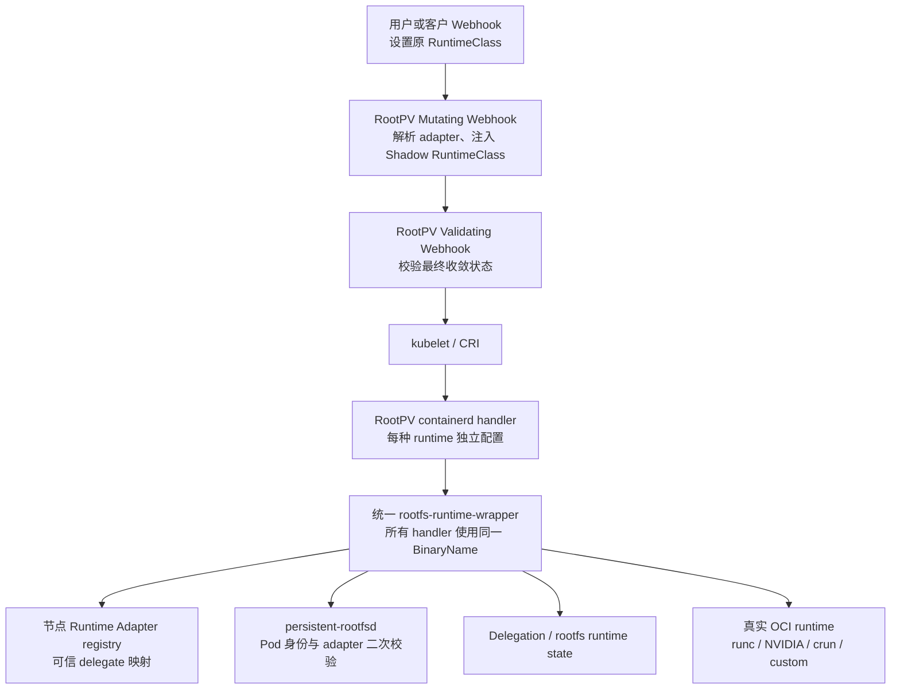

# RootPV 统一 Runtime Wrapper 与 Runtime Adapter 设计

> **2026-10-20 更新：** 已增加 [gVisor runsc adapter](06-gvisor-runsc-runtime-adapter-design.md)。
> io.containerd.runsc.v1 通过 shim TOML 的 binary_name 接入 OCI wrapper，生成配置关闭内部临时 overlay。
> 下文关于旧实现拒绝 gVisor 的叙述保留历史语境；当前能力以新设计和兼容性矩阵为准。

**文档状态：** 已评审

**设计日期：** 2026-07-16

**适用范围：** stock containerd、`io.containerd.runc.v2` 兼容 runtime、RootPV flat-lowerdirs 数据路径

> **2026-07-17 设计更新：** 本文关于“管理员手工登记 Runtime Adapter”、人工 adapter ID（例如 `runc-v1`）和静态节点 registry 生成的内容，已由 [RootPV Runtime Adapter 自动发现与配置生成设计](03-configmap-driven-runtime-adapter-extension-design.md) 取代。统一 wrapper、节点可信 registry、delegation state、fail-closed 和 runc-v2 兼容边界继续有效；新增 runtime 的发现、ID、RuntimeClass route 和 catalog 生成应以新设计为准。

> **2026-10-14 更新：** 本文的 OCI CLI、BinaryName 和 delegation 设计仅描述 runc-v2 路径。
> 当前实现额外提供 [Kata + QEMU task shim adapter](05-kata-qemu-task-shim-adapter-design.md)，
> 通过 runtime_path/task API 接入，不能套用本文的 OCI wrapper 配置。
> Kata 功能验证范围见 [兼容性矩阵](04-compatibility-validation-plan.md)。

## 1. 摘要

RootPV 当前只安装一个 `rootfs-runtime-wrapper` 二进制，但通过 `rootfs-runtime-wrapper-runc`、`rootfs-runtime-wrapper-nvidia` 等软链接名称选择后续真实 runtime。该机制安全直接，但每增加一种 runtime 都要同步增加软链接、containerd handler 配置和 wrapper basename 映射，扩展自定义 runtime 时运维成本较高。

本设计将所有受支持的 runc-v2 RootPV containerd handler 统一配置为同一个 `BinaryName`：

```text
/usr/local/bin/rootfs-runtime-wrapper
```

真实 runtime 不再由 wrapper 的文件名决定，而是由版本化 Runtime Adapter 解析。Pod annotation 只携带 adapter 的逻辑身份，不能携带宿主机可执行文件路径；真实 delegate binary 必须从节点可信配置解析，并在首次 `create` 前持久化到容器 runtime state，供后续 `state`、`kill`、`delete` 和异常恢复使用。

同时，本设计解决两个兼容性问题：

1. RootPV 不依赖自己与客户 Mutating Webhook 的执行顺序，通过可重入 mutation 和最终状态 validation 保证 RuntimeClass 没有被后续 Webhook 覆盖；
2. 用户未指定 RuntimeClass 时，可通过 `persistent-rootfs-node-default` 代理目标节点 containerd 的 `default_runtime_name`，而不是固定回退到 runc。

## 2. 评审结论建议

建议接受以下设计决策：

1. 所有 runc-v2 兼容 adapter 共用一个 wrapper 二进制路径，不再以软链接 basename 作为长期 runtime 路由协议；
2. 保留每种 runtime 对应的 Shadow RuntimeClass 和 containerd handler，因为不同 runtime 仍可能具有不同 handler options、调度条件和 overhead；
3. delegate 只能由节点可信 Runtime Adapter registry 解析，Pod annotation 不得直接指定 binary path；
4. Webhook 不依赖调用顺序，`IfNeeded` 只用于提高自动收敛概率，最终正确性由 Validating Webhook 校验；
5. 用户未指定 RuntimeClass 时，提供 `NodeDefault` 和 `Fixed` 两种策略，推荐 `NodeDefault` 保留节点原有默认 runtime 语义；
6. 非 runc-v2 task shim 不进入本设计支持范围，必须 fail closed，并通过独立 shim proxy RFC 评估。

## 3. 背景与当前实现

当前安装过程为：

```text
rootfs-runtime-wrapper-runc   -> rootfs-runtime-wrapper
rootfs-runtime-wrapper-nvidia -> rootfs-runtime-wrapper
```

containerd 为不同 RootPV handler 配置不同 `BinaryName`，wrapper 再根据 `argv[0]` 的 basename 查询：

```yaml
delegateRuntimeByWrapper:
  rootfs-runtime-wrapper-runc: /usr/bin/runc
  rootfs-runtime-wrapper-nvidia: /usr/bin/nvidia-container-runtime
```

因此，当前并不存在多套 wrapper 代码；不同软链接只是管理员控制的可信路由标记。该方案的主要优点是 wrapper 不需要相信 Pod annotation 即可选择 delegate，主要不足是 adapter 数量增加后需要维护大量名称耦合配置。

另有两个现状限制：

- Webhook 虽已配置 `reinvocationPolicy: IfNeeded`，但当前 validation 只检查 RuntimeClass 能否映射，没有严格检查最终 `spec.runtimeClassName` 是否仍等于期望的 RootPV Shadow RuntimeClass；
- 用户未指定 RuntimeClass 时，当前空值固定映射到 `persistent-rootfs-runc`，会绕过节点 containerd 的 `default_runtime_name`。

## 4. 目标与非目标

### 4.1 目标

- 所有受支持的 runc-v2 adapter 共用同一个 OCI wrapper 实现；
- 支持管理员显式登记新的 runc-v2 兼容 runtime，不再为每个 runtime 创建 wrapper 软链接；
- 保留原 RuntimeClass 的 runtime 行为、调度约束和 Pod overhead；
- 在 Webhook 任意执行顺序下，要么收敛到正确的 Shadow RuntimeClass，要么在 admission 阶段明确拒绝；
- 支持代理每个节点自己的 containerd 默认 runtime；
- 确保 sandbox、RootPV 目标容器、未启用 RootPV 的 sidecar 使用同一个正确 delegate；
- 容器创建后固定其 delegate 选择，配置更新不能让 delete 使用另一个 runtime；
- 所有不确定状态 fail closed，不静默回退到 runc。

### 4.2 非目标

- 自动执行 annotation 中给出的任意宿主机 binary；
- 把所有 runtime 合并成同一个 containerd handler；
- 通过本 OCI wrapper 自动支持独立 task shim；Kata QEMU 由 2026-10-14 的独立 task adapter 接入，runsc.v1 已通过独立 shim 配置 adapter 接入，见 2026-10-20 更新；
- 消除 RuntimeClass、containerd handler 和节点 runtime 安装要求；
- 在 admission 阶段推测尚未完成调度的 Pod 最终会落到哪个节点；
- 保证未指定 RuntimeClass 的 Pod 跨异构节点重建时仍使用相同 runtime。

## 5. 术语

| 术语 | 含义 |
| --- | --- |
| 原 RuntimeClass | 用户显式指定或客户 Webhook 注入的 RuntimeClass |
| Shadow RuntimeClass | RootPV 创建的 RuntimeClass，handler 指向 RootPV containerd handler |
| Runtime Adapter | 原 RuntimeClass、Shadow RuntimeClass、handler、runtime type 和 delegate binary 的受信任映射 |
| Explicit Adapter | 由明确的原 RuntimeClass 选择的 adapter |
| Node Default Adapter | 用户未指定 RuntimeClass 时，在目标节点解析 containerd 默认 handler 的逻辑 adapter |
| Delegate | wrapper 处理完成后执行的真实 OCI runtime binary |
| Delegation State | 按 container ID 持久化的 adapter 和 delegate 选择结果 |

## 6. 总体架构



统一 wrapper 不等于统一 handler。每个 adapter 仍保留独立 handler，以承载不同的 `runtime_type`、snapshotter、cgroup、privileged device 和其他 runtime options；它们只把 `BinaryName` 统一指向 RootPV wrapper。

## 7. Runtime Adapter 数据模型

### 7.1 集群级显式 Adapter

建议使用版本化配置：

```yaml
apiVersion: openfuyao.cn/v1alpha1
runtimeAdapters:
  - id: nvidia-v1
    mode: Explicit
    originalRuntimeClass: nvidia
    originalHandler: nvidia
    rootpvRuntimeClass: persistent-rootfs-nvidia
    rootpvHandler: persistent-rootfs-nvidia
    runtimeType: io.containerd.runc.v2
    delegateBinary: /usr/bin/nvidia-container-runtime
```

`id` 必须稳定且不可复用。若 adapter 的 runtime type、delegate 语义或关键 handler option 发生不兼容变化，应创建新版本 ID，而不是原地改变旧 ID 的含义。

### 7.2 Node Default Adapter

Node Default 使用固定的逻辑身份：

```yaml
id: node-default
mode: NodeDefault
rootpvRuntimeClass: persistent-rootfs-node-default
rootpvHandler: persistent-rootfs-node-default
```

它不在 admission 阶段绑定具体 delegate。节点 agent 从本机 containerd 配置解析：

```text
default_runtime_name
  -> 对应 handler
  -> runtime_type
  -> handler options
  -> delegate BinaryName
```

节点解析结果写入仅 root 可修改的本地 registry，并产生节点本地 config digest。

### 7.3 可信节点 Registry

建议节点配置模型为：

```yaml
formatVersion: rootpv-runtime-adapters-v1
adapters:
  nvidia-v1:
    mode: Explicit
    rootpvHandler: persistent-rootfs-nvidia
    runtimeType: io.containerd.runc.v2
    delegateBinary: /usr/bin/nvidia-container-runtime
    configDigest: sha256:...
  node-default:
    mode: NodeDefault
    sourceHandler: crun
    rootpvHandler: persistent-rootfs-node-default
    runtimeType: io.containerd.runc.v2
    delegateBinary: /usr/local/bin/crun
    configDigest: sha256:...
```

该文件必须位于可信宿主机目录，使用 root ownership、不可被 Pod volume 覆盖，并通过原子替换更新。

## 8. Webhook 无序执行设计

### 8.1 不能依赖执行顺序

Kubernetes 不保证不同 Mutating Webhook 的稳定执行顺序。RootPV 不得通过 WebhookConfiguration 名称排序来保证自己在客户 Webhook 之后执行。

RootPV Mutating Webhook 继续设置：

```yaml
reinvocationPolicy: IfNeeded
```

`IfNeeded` 允许对象被后续 admission plugin 修改后再次调用 RootPV，但额外调用次数和再次调用时机不能作为最终正确性保证。RootPV mutation 必须幂等，最终状态必须由 Validating Webhook 校验。

### 8.2 保留 Annotation

新增或规范以下 annotation：

```text
openfuyao.cn/original-runtime-class
openfuyao.cn/effective-runtime-class
openfuyao.cn/runtime-adapter-id
openfuyao.cn/runtime-adapter-mode
openfuyao.cn/runtime-adapter-config-hash
openfuyao.cn/persistent-rootfs-mutated
```

约束：

- annotation 只能携带 adapter ID、模式和摘要，不能携带 delegate binary path；
- Mutating Webhook 必须覆盖用户预先设置的保留 annotation；
- Shadow RuntimeClass 属于内部 API，用户不能通过手工组合 annotation 绕过 adapter 解析；
- `NodeDefault` 的具体节点 digest 在 admission 时未知，Pod 只保存集群级逻辑配置摘要；节点解析摘要保存在 delegation state。

### 8.3 幂等 Mutation 算法

对显式启用 RootPV 的 Pod：

1. 若当前 `runtimeClassName` 是普通 RuntimeClass，将它视为客户当前最终选择，查询 Explicit Adapter；
2. 若当前 `runtimeClassName` 为空，根据 `defaultRuntimePolicy` 选择 `NodeDefault` 或固定 adapter；
3. 若当前值已经是合法 Shadow RuntimeClass，校验现有 adapter annotation 是否一致；一致则不重复修改；
4. 将原 RuntimeClass、adapter ID、模式、期望 Shadow RuntimeClass 和配置摘要写入 annotation；
5. 将 `spec.runtimeClassName` 设置为 adapter 的 Shadow RuntimeClass；
6. adapter 不存在、Shadow RuntimeClass 被非法直接使用或状态互相矛盾时拒绝 admission。

当 RootPV 先执行、客户 Webhook 后设置新的 RuntimeClass 时，RootPV 的重入调用会把客户的新值当作原 RuntimeClass 重新解析。如果未发生重入，则最终 validation 必须发现 Shadow RuntimeClass 被覆盖并拒绝 Pod。

### 8.4 最终状态 Validation

Validating Webhook 在全部 mutation 完成后重新校验以下不变量：

```text
spec.runtimeClassName == adapter.rootpvRuntimeClass
effective-runtime-class == adapter.rootpvRuntimeClass
original-runtime-class == adapter.originalRuntimeClass       # Explicit
runtime-adapter-id == adapter.id
runtime-adapter-mode == adapter.mode
adapter config hash 与控制面配置一致                         # Explicit
```

以下状态必须拒绝：

- 客户 Webhook 在 RootPV 之后把 `runtimeClassName` 改回原 RuntimeClass；
- annotation 表示 adapter A，但最终 RuntimeClass 属于 adapter B；
- 用户直接指定内部 Shadow RuntimeClass，却没有合法 mutation 状态；
- adapter 已删除或配置摘要不匹配；
- `NodeDefault` 被伪装成 Explicit Adapter；
- 不支持的 runtime type 或节点能力集合中不存在可运行该 adapter 的节点。

建议使用稳定 reason：

```text
runtimeclass_mutation_overwritten
runtime_adapter_not_found
runtime_adapter_state_mismatch
shadow_runtimeclass_direct_use_denied
unsupported_runtime_type
runtime_adapter_not_ready
```

若客户 Webhook 持续覆盖 RootPV Shadow RuntimeClass，两个 Webhook 对同一字段存在策略冲突。RootPV 必须拒绝 Pod 并要求客户 Webhook 识别 RootPV mutation，不能通过不稳定的执行顺序掩盖冲突。

## 9. 节点默认 Runtime 代理

### 9.1 当前问题

Kubernetes Pod 未指定 `runtimeClassName` 时，CRI 使用默认 RuntimeHandler，containerd 再根据 `default_runtime_name` 选择本节点默认 handler。当前 RootPV 将空 RuntimeClass 固定映射到 `persistent-rootfs-runc`，会绕过客户的节点默认 runtime。

### 9.2 `persistent-rootfs-node-default`

集群创建统一 Shadow RuntimeClass：

```yaml
apiVersion: node.k8s.io/v1
kind: RuntimeClass
metadata:
  name: persistent-rootfs-node-default
handler: persistent-rootfs-node-default
scheduling:
  nodeSelector:
    openfuyao.cn/rootpv-node-default-ready: "true"
```

每个节点生成同名 containerd handler，但 handler 内容可根据本节点 default runtime 不同而不同：

```toml
[plugins."io.containerd.grpc.v1.cri".containerd.runtimes.persistent-rootfs-node-default]
  runtime_type = "io.containerd.runc.v2"
  snapshotter = "overlayfs"
  pod_annotations = ["openfuyao.cn/*"]
  container_annotations = ["openfuyao.cn/*"]

  [plugins."io.containerd.grpc.v1.cri".containerd.runtimes.persistent-rootfs-node-default.options]
    BinaryName = "/usr/local/bin/rootfs-runtime-wrapper"
    SystemdCgroup = true
```

除 `BinaryName` 外，必须继承原默认 handler 的必要语义，不能只复制 `SystemdCgroup`。

### 9.3 默认策略

建议暴露：

```yaml
defaultRuntimePolicy: NodeDefault | Fixed
fixedDefaultAdapter: runc-v1
```

| 策略 | 行为 | 适用场景 |
| --- | --- | --- |
| `NodeDefault` | 未指定 RuntimeClass 时代理目标节点 containerd 默认 runtime | 最大程度保留客户现有节点行为，推荐默认 |
| `Fixed` | 未指定 RuntimeClass 时使用集群固定 adapter | 要求跨节点 runtime 可重复、兼容当前固定 runc 行为 |

`NodeDefault` 允许不同节点使用不同真实 runtime。这与 Kubernetes 未指定 RuntimeClass 时的原始语义一致，但 Pod 跨节点重建后 runtime 可能改变。对 runtime 一致性有严格要求的工作负载必须显式指定 RuntimeClass 或使用 `Fixed`。

### 9.4 节点 Readiness

节点只有同时满足以下条件时才能发布：

```text
openfuyao.cn/rootpv-node-default-ready=true
```

- 成功解析 containerd `default_runtime_name`；
- 默认 handler 存在；
- runtime type 属于支持矩阵；
- delegate binary 存在、可执行且不指向 RootPV wrapper；
- RootPV Shadow handler 与本地 registry 配置摘要一致；
- containerd 已加载对应配置；
- wrapper 和 rootfsd 版本支持该 registry format。

默认 runtime 变化时，节点必须先撤销 readiness，更新 handler 和 registry，验证 containerd 配置后再恢复 readiness。已有容器继续使用其持久化的 delegation state。

## 10. containerd Handler 设计

### 10.1 Handler 仍按 Runtime 区分

统一 wrapper 后仍保留：

```text
persistent-rootfs-runc
persistent-rootfs-nvidia
persistent-rootfs-company-custom
persistent-rootfs-node-default
```

它们可以具有不同的：

- `runtime_type`；
- snapshotter；
- `SystemdCgroup`、`NoPivotRoot` 等 shim options；
- privileged device 行为；
- pod/container annotation allowlist；
- RuntimeClass scheduling 和 overhead。

所有受支持 runc-v2 handler 只统一：

```toml
BinaryName = "/usr/local/bin/rootfs-runtime-wrapper"
```

### 10.2 Handler 克隆要求

节点 configurator 必须从原 handler 或节点默认 handler 克隆允许的完整配置集合，并明确区分：

- 必须继承的字段；
- 必须由 RootPV 覆盖的字段；
- 禁止继承的危险字段；
- 版本未知时必须拒绝的字段。

不能通过手写少量字段假定不同 runtime 只有 BinaryName 不同。生成配置后必须使用 `containerd config dump` 或等价机制验证实际加载结果。

## 11. Wrapper 委托流程

### 11.1 Delegate 解析顺序

wrapper 不再在解析命令和 OCI spec 之前根据自身 basename 选择 delegate。新的顺序为：

```text
解析 runtime CLI invocation
  -> 若已有 container state，读取固定的 delegate
  -> 若为首次 create，读取 OCI spec 中的 adapter annotation
  -> 在节点可信 registry 中解析 adapter
  -> 校验 RuntimeClass、mode 和 config digest
  -> 持久化 delegation state
  -> 按目标类型处理 rootfs 或直接委托
```

### 11.2 RootPV 目标容器

RootPV 目标容器的 `create` 流程为：

1. 解析 adapter 并完成本地可信 registry 校验；
2. 从 OCI/containerd metadata 取得 Pod UID、container identity 和 snapshot identity；
3. 调用 rootfsd，交叉校验 Pod、RootPV spec 和 adapter；
4. 在真实 runtime 启动前原子保存 adapter、delegate 和 rootfs lifecycle state；
5. mount flat overlay、改写 OCI root path；
6. 通过现有 delegate registration handshake 启动真实 runtime；
7. commit create phase。

### 11.3 Sandbox、Sidecar 与非目标容器

RuntimeClass 是 Pod 级配置，因此 sandbox 和未命中 RootPV target 的 sidecar 也可能进入统一 wrapper。它们虽然不执行 RootPV mount，仍必须：

1. 在首次 `create` 时解析并校验相同 adapter；
2. 在调用真实 runtime 前保存只包含 delegate 信息的轻量 delegation state；
3. 后续 `state`、`kill`、`delete` 使用该 state；
4. 成功 delete 后删除 delegation state。

不能对 sandbox 或 sidecar 无条件使用默认 runc，否则同一个 Pod 可能由不一致的 runtime 创建。

### 11.4 后续 Runtime 命令

`state`、`kill`、`delete` 等命令可能没有 bundle，不能重新读取 Pod annotation。wrapper 必须根据 container ID 加载创建时保存的 delegate。

如果 state 缺失，只能在 containerd metadata、Pod UID 和 adapter registry 均可交叉证明同一 adapter 时恢复；否则 fail closed，由 reconciler 或管理员诊断处理，不能回退到默认 runc。

### 11.5 无 Container 上下文的命令

`--version`、`features` 或其他没有 bundle/container ID 的命令无法通过 adapter annotation 选择真实 runtime。统一 wrapper 必须明确采用以下策略之一：

- wrapper 自己返回稳定版本信息和所有受支持 delegate 的保守 feature 交集；或
- 对某个 adapter 必须精确转发的 context-free 命令保留兼容 alias，直到 containerd/runtime 调用链提供可靠 adapter context。

首发前必须抓取 containerd shim 对所有受支持 runtime 的真实 CLI 调用矩阵。不能假定只有 `create` 和 `delete`，也不能对未知命令静默委托 runc。

## 12. rootfsd 的 Adapter 校验

wrapper 读取到的 OCI annotation 是路由提示，不是单独的授权事实。对于 RootPV 目标容器，rootfsd 应基于节点 Pod informer 中的真实对象校验：

```text
Pod UID
Pod.spec.runtimeClassName
original/effective RuntimeClass annotation
adapter ID 和 mode
RootPV target container
节点 adapter readiness/config digest
```

建议 `ResolveRootfsResponse` 增加：

```json
{
  "runtime_adapter_id": "nvidia-v1",
  "runtime_adapter_mode": "Explicit",
  "delegate_binary": "/usr/bin/nvidia-container-runtime",
  "adapter_config_digest": "sha256:..."
}
```

wrapper 必须确认 rootfsd 返回结果与本地 registry 解析一致。两者不一致说明控制面、节点配置或 Pod 状态发生漂移，必须拒绝 create。

为避免 sandbox 创建早于 rootfsd Pod 注册造成启动死锁，sandbox 和非 RootPV 目标容器使用 Webhook 已收敛状态与节点可信 registry完成 delegate 解析，不要求先取得 rootfs lease；但仍必须保存 delegation state。

## 13. Delegation State

建议所有进入 RootPV Shadow handler 的 container 都保存最小状态：

```json
{
  "formatVersion": "rootpv-delegation-v1",
  "containerID": "...",
  "podUID": "...",
  "containerName": "...",
  "runtimeAdapterID": "nvidia-v1",
  "runtimeAdapterMode": "Explicit",
  "sourceHandler": "nvidia",
  "rootpvHandler": "persistent-rootfs-nvidia",
  "runtimeType": "io.containerd.runc.v2",
  "delegateBinary": "/usr/bin/nvidia-container-runtime",
  "adapterConfigDigest": "sha256:...",
  "rootfsEnabled": true,
  "phase": "creating"
}
```

要求：

- 必须在第一次调用真实 runtime 前原子持久化；
- RootPV 目标容器可与现有 flat rootfs state 合并，sandbox/sidecar 保存轻量状态；
- delete 使用 state 中固定的 delegate，不使用当前 registry 重新选择；
- adapter 配置升级时旧 adapter 和 delegate 必须保留到存量 state 清零；
- state 中 binary path 是生命周期事实，但恢复时仍需验证它没有指向 wrapper、文件存在且属于允许位置；
- 成功 delete 并确认 runtime 不存在后才能删除 state。

## 14. 信任与安全边界

### 14.1 不可信输入

- 用户 Pod spec 和用户提供的 annotation；
- OCI spec 中未经交叉校验的 annotation；
- 用户可写 PVC 中的所有文件；
- annotation 中出现的 binary path、handler 或 config digest。

### 14.2 可信输入

- admission 使用的管理员 Runtime Adapter 配置；
- Kubernetes API 中通过 Pod UID 查询到的最终对象；
- root ownership 的节点 adapter registry；
- containerd 实际加载的 handler 配置；
- rootfsd Unix socket 返回且经本地 registry 交叉校验的结果；
- 创建前已原子持久化的 delegation state。

### 14.3 Delegate 校验

真实 binary 必须：

- 来自节点 registry，不来自 Pod path 字符串；
- 使用绝对路径；
- 位于管理员允许的 runtime 目录；
- 存在且可执行；
- 解析 symlink 后不能指向 RootPV wrapper；
- 不允许 adapter A 通过 symlink 递归调用 adapter B 的 wrapper；
- 在 readiness 和每次首次 create 时重新检查基本文件事实。

## 15. 错误处理

| 场景 | 行为 |
| --- | --- |
| 客户 Webhook 覆盖 Shadow RuntimeClass | validating admission 拒绝 |
| adapter annotation 被伪造 | mutation 覆盖或 validation 拒绝 |
| adapter 未注册 | admission fail closed |
| 节点没有对应 handler/delegate | 不发布 readiness，避免调度 |
| 本地 registry 与 rootfsd 结果不一致 | 拒绝 create，保留诊断信息 |
| delegation state 写入失败 | 不调用真实 runtime |
| delete 时 state 缺失 | 只有可交叉证明时恢复，否则 fail closed |
| adapter 配置已升级 | 已有容器使用 state 中旧 adapter；新容器使用新版本 |
| NodeDefault runtime type 不支持 | 节点不发布 node-default readiness |
| delegate 指向 wrapper 自身 | 拒绝 readiness/create，报告递归配置错误 |
| context-free runtime 命令无法路由 | wrapper 自行处理或显式拒绝，不回退 runc |

## 16. 兼容性边界

| Runtime 类型 | 统一 wrapper 支持状态 | 条件 |
| --- | --- | --- |
| runc | 支持目标 | runc-v2 handler 和完整 E2E |
| NVIDIA container runtime | 支持目标 | runc-v2/BinaryName 兼容、GPU E2E |
| crun | 可适配 | CLI、features、状态与删除语义验证 |
| Ascend/ROCm/MThreads runtime | 可适配 | 必须证明使用 runc-v2 BinaryName 路径并逐 adapter E2E |
| 企业自定义 runc wrapper | 可适配 | 显式 registry、handler clone 和 CLI 兼容验证 |
| Kata + QEMU | 独立 task adapter | 不进入 OCI BinaryName wrapper；明确 QEMU 配置时通过 task proxy，见新设计 |
| Kata CLH | 不支持 | 无对应 task adapter |
| gVisor/runsc.v1 | 独立 shim 配置 adapter | binary_name 委托 OCI wrapper、overlay2=none；见 [设计](06-gvisor-runsc-runtime-adapter-design.md) |

统一 wrapper 改善的是 runc-v2 adapter 的配置扩展性，不扩大 BinaryName hook 本身的技术边界。

## 17. 部署与迁移

建议分阶段迁移：

### 阶段 1：双协议兼容

- wrapper 同时支持旧 basename 映射和新 adapter registry；
- Webhook 注入 adapter annotation，但现有 handler 仍使用旧 alias；
- 验证 adapter 解析结果与 basename 映射完全一致；
- 新 delegation state 保存两种选择证据，发现不一致立即拒绝。

### 阶段 2：切换统一 BinaryName

- 为每个 adapter 生成使用统一 wrapper 的新 handler 配置；
- 节点通过 config dump、delegate probe 和 readiness 检查后逐步启用；
- Shadow RuntimeClass 映射切换到新 handler；
- 旧容器继续通过旧 state/alias 清理。

### 阶段 3：启用 NodeDefault

- 节点 agent 解析并克隆 `default_runtime_name`；
- 创建 `persistent-rootfs-node-default` RuntimeClass；
- 先以显式配置开关启用，再决定是否将 `NodeDefault` 设为默认策略；
- 异构节点必须通过 RuntimeClass scheduling label 限定可调度范围。

### 阶段 4：移除旧 Alias

- 确认没有旧格式 delegation/rootfs state；
- 确认 containerd 配置中不再引用旧 alias；
- 删除 basename 映射和软链接；
- 保留版本升级检查，发现旧配置时拒绝卸载兼容能力。

## 18. 验证计划

### 18.1 Webhook 组合测试

至少构造以下顺序：

1. 客户 Webhook 先注入 RuntimeClass，RootPV 后执行；
2. RootPV 先执行，客户 Webhook 后注入 RuntimeClass，RootPV 被重入；
3. RootPV 先执行，客户 Webhook 后覆盖且未再次收敛，由 validation 拒绝；
4. 客户 Webhook 持续把 Shadow RuntimeClass 改回原值；
5. 用户直接指定 Shadow RuntimeClass；
6. 用户伪造 adapter ID、mode 和 config hash；
7. adapter 配置在 mutation 与 validation 之间更新；
8. 多个客户 Webhook 分别修改 RuntimeClass 和 GPU resource。

必须验证最终结果只有“正确 Shadow RuntimeClass”或“明确 admission 拒绝”，不能出现 RootPV annotation 存在但 wrapper 未被调用。

### 18.2 Runtime Adapter 测试

- 所有 runc-v2 RootPV handler 的 BinaryName 指向统一 wrapper 实现的生成别名；
- adapter ID 到 delegate 的正向、缺失、重复和递归映射；
- handler options clone 与原 handler 等价；
- registry 原子更新和配置摘要漂移；
- adapter 升级期间新旧容器分别使用正确版本；
- context-free CLI 命令、全局 flag 和子命令组合。

### 18.3 生命周期测试

- sandbox、目标容器、普通 sidecar 使用同一 adapter；
- create 前 state 写入失败时真实 runtime 未执行；
- create 成功、commit 前崩溃；
- state/kill/delete 没有 bundle 时根据 delegation state 委托；
- delete 时 registry 已更新或 adapter 已标记退役；
- state 丢失、损坏或 delegate binary 缺失；
- wrapper、rootfsd、containerd 重启和节点 reboot。

### 18.4 NodeDefault 测试

- 默认 runc、NVIDIA runtime、crun 和企业 runtime；
- 不同节点具有不同 `default_runtime_name`；
- 默认 handler 修改和 containerd 重启期间 readiness 变化；
- Pod 跨节点重建后使用目标节点默认 runtime；
- 默认 runtime 为未实现类型（例如 Kata CLH/未知 shim）时明确标记不支持；QEMU 类型按新 task adapter 规则判定；
- 用户显式 RuntimeClass 优先于 NodeDefault；
- `Fixed` 策略保持集群固定 adapter。

## 19. 可观测性

建议日志和指标至少包含：

```text
runtime_adapter_id
runtime_adapter_mode
original_runtime_class
effective_runtime_class
rootpv_handler
source_handler
runtime_type
delegate_binary
adapter_config_digest
delegation_state_phase
delegate_resolution_source
```

建议指标：

```text
rootpv_runtime_adapter_resolve_total{adapter,mode,result}
rootpv_runtimeclass_final_validation_total{result,reason}
rootpv_runtime_delegate_total{adapter,command,result}
rootpv_runtime_adapter_config_mismatch_total{adapter}
rootpv_node_default_ready{node,runtime_type}
rootpv_delegation_state_recovery_total{result}
```

禁止在日志中输出不受信任 annotation 指定的路径并把它描述为实际 delegate；日志中的 delegate 必须来自可信 registry 或已验证 state。

## 20. 备选方案与取舍

### 20.1 保留不同 Wrapper Alias

优点是 runtime 选择来自 containerd handler 配置，信任链最简单；缺点是 adapter 数量增加后软链接和 basename 映射膨胀。可作为迁移期兼容和 context-free CLI 命令的兜底，但不作为长期扩展接口。

### 20.2 Annotation 直接指定 Delegate Path

实现最简单，但把 Pod 输入提升为宿主机代码执行选择，不满足安全边界，明确拒绝。

### 20.3 Wrapper 直接查询 Kubernetes API

可以获得最终 Pod RuntimeClass，但会让每次 OCI runtime 调用依赖 apiserver 可用性，并增加启动延迟和节点权限。目标容器由 rootfsd informer 二次校验，wrapper 使用本地 registry 和持久化 state，避免直接访问 apiserver。

### 20.4 合并为单一 containerd Handler

无法保留不同 runtime 的 shim options、调度与 overhead 语义，也无法让 containerd 在 wrapper 前应用 adapter 特有配置，因此不采用。

## 21. 首发阻塞项

以下事项完成前，统一 wrapper 不能替换现有 alias 路径：

1. Validating Webhook 严格校验最终 RuntimeClass 和 adapter 不变量；
2. 所有进入 Shadow handler 的 sandbox/container 都具备 delegation state；
3. state/delete/kill 等无 bundle 命令使用固定 delegate；
4. context-free CLI 调用矩阵和处理策略完成验证；
5. 节点 registry 权限、原子更新和递归 binary 校验完成；
6. handler clone 规则和 `containerd config dump` readiness 验证完成；
7. runc、NVIDIA 与至少一个自定义 runc-v2 runtime E2E；
8. Webhook 任意顺序、重入和覆盖冲突测试完成；
9. NodeDefault 在同构与异构节点完成验证；
10. 从旧 alias/state 到新 adapter/state 的升级与回滚流程完成。

## 22. 待评审问题

1. `defaultRuntimePolicy` 首发默认值采用 `NodeDefault`，还是为兼容当前行为暂时采用 `Fixed(runc-v1)`？
2. context-free `features` 命令使用 wrapper 自己返回的保守交集，还是迁移期保留 adapter alias？
3. Runtime Adapter 首发使用 ConfigMap 配置，还是直接定义集群级 CRD？
4. adapter ID 发生不兼容变更时，是否强制新建版本 ID并执行节点 drain？
5. 节点默认 runtime 在不同节点不一致时，是否仅通过 readiness label允许，还是要求用户显式开启异构 NodeDefault？

## 23. 参考资料

- RootPV 社区项目评审：`docs/design/k8s-persistent-rootfs-community-project-review.md`
- RootPV 单层替换备选方案：`docs/design/backup-plan-wait-review.md`
- Kubernetes RuntimeClass：<https://kubernetes.io/docs/concepts/containers/runtime-class/>
- Kubernetes Dynamic Admission Control：<https://kubernetes.io/docs/reference/access-authn-authz/extensible-admission-controllers/>
- Kubernetes Admission Webhook Good Practices：<https://kubernetes.io/docs/concepts/cluster-administration/admission-webhooks-good-practices/>
- containerd CRI configuration：<https://github.com/containerd/containerd/blob/main/docs/cri/config.md>
- containerd Runtime v2：<https://github.com/containerd/containerd/blob/main/docs/runtime-v2.md>
- OCI Runtime Specification：<https://github.com/opencontainers/runtime-spec>
