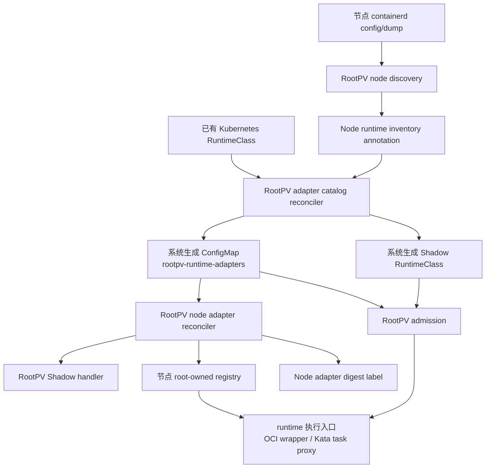

# RootPV Runtime Adapter 自动发现与配置生成设计

> **2026-11-12 更新：** Ascend 950DT 同样复用现有 runc-v2 adapter，无需新增 Go 分支。
> 宿主按厂商方案配置 udma 并重启后，已完成实际计算、持久化、服务重启后计算和 Webhook/catalog 验证，
> 见 [950DT 记录](../../tests/e2e/results/ascend-950-2026-11-12.md)；不外推到其他型号、vNPU 或 HCCL。

> **2026-11-11 更新：** Ascend 910C 复用现有 runc-v2 发现、shadow handler 和 OCI 委托链。
> NPU 分配和原厂 hook 由 device plugin/runtime 负责，不增加芯片 ID 或驱动版本解析。
> containerd v3 与 plugin 部署前提见 [Ascend 指南](../user-guide/ascend.md)，
> [实机记录](../../tests/e2e/results/ascend-910c-2026-11-11.md) 只覆盖列明的非切分芯片组合。

> **2026-11-08 更新：** NVIDIA 沿用 runc-v2 adapter，不增加厂商设备解析分支。
> GPU Operator 导入 v3 配置时仅使用生效的 v3 CRI runtime 表；设备仍由 device plugin 与 Toolkit/CDI 注入。
> 镜像快照支持 containerd 的长 lowerdir 压缩表示，并继续逐层核对快照来源。
> 空 catalog 经 YAML 往返后保持 generation 稳定，避免配置空窗反复触发重载。
> 驱动与 MIG 边界见 [NVIDIA 指南](../user-guide/nvidia.md)，证据见 [兼容性矩阵](04-compatibility-validation-plan.md)。

> **2026-10-20 更新：** 已增加 [gVisor runsc adapter](06-gvisor-runsc-runtime-adapter-design.md)。
> io.containerd.runsc.v1 通过 shim TOML 的 binary_name 接入 OCI wrapper，生成配置关闭内部临时 overlay。
> 下文关于旧实现拒绝 gVisor 的叙述保留历史语境；当前能力以新设计和兼容性矩阵为准。

**文档状态：** 已评审

**设计日期：** 2026-07-17

**基线设计：** [RootPV 统一 Runtime Wrapper 与 Runtime Adapter 设计](02-unified-runtime-wrapper-runtime-adapter-design.md)

**适用范围：** 已安装的 runc-v2 OCI runtime，以及显式配置 QEMU 的 Kata task shim；两种接口独立适配。

> **2026-10-14 更新：** 自动发现新增 Kata + QEMU task shim adapter，支持
> io.containerd.kata-qemu.v2 和明确配置 QEMU 的 io.containerd.kata.v2。
> runc 仍使用 OCI BinaryName wrapper，Kata 使用 runtime_path 的独立代理。
> 下文涉及规划中的并发配置锁、退役和版本迁移要求，需按实现与
> [兼容性验证矩阵](04-compatibility-validation-plan.md)区分已落实与待验证能力。
> Kata 生命周期以 [task shim 设计](05-kata-qemu-task-shim-adapter-design.md) 为准。

## 1. 结论

RootPV 不应要求管理员手工编写 Runtime Adapter ConfigMap。handler 名称、runtime type、delegate binary、handler options、节点默认 runtime 和节点支持状态都可以从 Kubernetes RuntimeClass、Node 对象和节点 containerd 配置中获取，应由系统自动发现、校验和生成。

目标工作流调整为：

```text
厂商 runtime/device plugin/RuntimeClass 已安装
  -> node-agent 自动扫描 containerd runtime handlers
  -> node-agent 发布节点 runtime inventory
  -> controller 结合已有 RuntimeClass 聚合 adapter 和 route
  -> controller 自动生成只读 Runtime Adapter ConfigMap
  -> node-agent 自动生成 Shadow handler、本地 registry 和 readiness label
  -> admission 自动使用生成的 route
```

完成一次通用化实现后，新增 Ascend、ROCm 或企业自定义 runc-v2 runtime 时：

- 不修改 RootPV 代码；
- 不重新编译或发布 RootPV 镜像；
- 不手写 RootPV ConfigMap；
- 不手工维护 adapter ID 或 digest；
- 只需要厂商 runtime 在节点上已经可用，并补充对应的 RootPV E2E 测试。

系统自动生成的 ConfigMap 是“发现结果和控制面目录”，不是用户输入。管理员主要通过它查询 RootPV 当前发现和支持了哪些 runtime。

## 2. 对上一版设计的修正

上一版要求管理员填写以下信息：

```text
source handler
runtime type
delegate binary/fallback paths
allowed directories
resource names
required device paths
Shadow RuntimeClass/handler
adapter ID 和版本
```

这些字段大部分不应由管理员重复输入：

- `RuntimeClass.spec.handler` 已给出 source handler；
- containerd handler 已给出 runtime type、BinaryName 和其他 options；
- Node allocatable 已给出设备资源；
- 节点文件系统可以验证 delegate 是否存在、可执行和是否递归指向 wrapper；
- Shadow RuntimeClass/handler 可以按确定规则生成；
- adapter ID 和 digest 可以由 handler/runtime type 自动计算；
- readiness 应来自节点实际收敛结果，而不是管理员声明。

因此新设计删除 desired/accepted 双 ConfigMap 和管理员 schema，改为“节点 inventory + controller-generated catalog”。

## 3. 目标与边界

### 3.1 目标

- 自动发现 runc-v2 source handler，以及显式配置 QEMU 的 Kata source handler；
- 自动生成稳定、可解释、无人工版本歧义的 adapter ID；
- 自动发现 Kubernetes RuntimeClass 到 source handler 的映射；
- 自动创建 Shadow RuntimeClass 和 RootPV containerd handler；
- 自动生成集群 Runtime Adapter ConfigMap 和节点可信 registry；
- 自动发布每个 adapter 的节点 readiness；
- 新 runtime 接入不引入厂商名称分支；
- adapter 更新不改变已有容器持久化的 delegate；
- 无法证明兼容性时 fail closed。

### 3.2 非目标

- 安装厂商驱动、device plugin、固件或 OCI runtime；
- 自动支持任意 task shim、Kata CLH 或未知 runsc 类型；通用 Kata 类型仅在 QEMU 配置满足条件时接入；
- 根据 runtime 名称猜测 binary 路径；
- 根据 `huawei.com/*`、`nvidia.com/*` 等资源名前缀猜测对应 handler；
- 自动执行节点上的任意探测脚本；
- 修改或接管普通 Pod 的 runtime；
- 让正在运行的容器因节点配置更新而切换 delegate。

RootPV 的自动发现从“厂商 runtime 已正确安装”开始。厂商 source handler 本身不工作时，RootPV 不负责修复它。

## 4. 核心模型：Adapter 与 Route 分离

旧模型把 runtime 执行身份和 RuntimeClass 映射放在同一个 adapter 记录里，导致同一个 handler 被多个 RuntimeClass 使用时需要重复配置。

新模型拆为两层：

### 4.1 Runtime Adapter

表示节点上的真实执行机制，由以下事实唯一确定：

```text
source handler + runtime type
```

例如：

| source handler | runtime type | 自动 adapter ID |
| --- | --- | --- |
| `runc` | `io.containerd.runc.v2` | `runc-v2` |
| `nvidia` | `io.containerd.runc.v2` | `nvidia-runc-v2` |
| `ascend` | `io.containerd.runc.v2` | `ascend-runc-v2` |
| `crun` | `io.containerd.runc.v2` | `crun-runc-v2` |
| `company-gpu` | `io.containerd.runc.v2` | `company-gpu-runc-v2` |
| `kata-qemu` | `io.containerd.kata-qemu.v2` | `kata-qemu-v2` |
| `kata` | `io.containerd.kata.v2`，QEMU 配置 | `kata-kata-qemu-v2` |

adapter 不包含用户 RuntimeClass 名称，也不包含集群统一的 delegate path。delegate 是节点本地事实，允许不同节点安装在不同绝对路径。

### 4.2 Runtime Route

表示用户 RuntimeClass 到 RootPV Shadow RuntimeClass 的路由：

```text
original RuntimeClass
  -> source handler
  -> adapter ID
  -> Shadow RuntimeClass
```

例如：

```text
RuntimeClass/ascend
  handler=ascend
  -> adapter=ascend-runc-v2
  -> RuntimeClass/persistent-rootfs-ascend
```

多个原 RuntimeClass 可以指向同一个 adapter，同时保留各自不同的 `overhead`、scheduling 和 tolerations。

## 5. Adapter ID 自动生成规范

### 5.1 基本规则

adapter ID 不是人工版本号，也不是厂商产品版本。它是 source handler 和 containerd runtime interface 的规范化名称。

`io.containerd.runc.v2` 对应 runtime interface token：

```text
runc-v2
```

生成算法：

```text
handlerToken = normalizeDNSLabel(sourceHandler)
if runtimeType == "io.containerd.runc.v2":
    runtimeToken, baseHandler = "runc-v2", "runc"
elif runtimeType in {"io.containerd.kata-qemu.v2", "io.containerd.kata.v2"}:
    requireExplicitQemuConfig()
    runtimeToken, baseHandler = "kata-qemu-v2", "kata-qemu"
else:
    unsupported()

if handlerToken == baseHandler:
    id = runtimeToken
else:
    id = handlerToken + "-" + runtimeToken
```

因此 stock runc 得到 runc-v2；handler 名为 kata-qemu 时得到 kata-qemu-v2。
同样的源 handler 名配合不同 runtime type 必须保持类型一致，不因名称像 Kata 就绕过 QEMU 验证。

### 5.2 规范化和冲突

- 转为小写；
- 非 `[a-z0-9-]` 字符转换为 `-`；
- 合并连续 `-`，去掉首尾 `-`；
- 最长 45 字符，确保派生的 Kubernetes label/handler 名称不超限；
- 超长时保留可读前缀并追加 source handler/runtime type 的 8 位 hash；
- 两个原始 handler 规范化后冲突时，二者都追加稳定 hash；
- RootPV 管理的 `persistent-rootfs-*` handler 永远不参与发现，避免递归生成。

示例：

```text
source handler: vendor.example.com/Ascend_910
normalized:     vendor-example-com-ascend-910
adapter ID:     vendor-example-com-ascend-910-runc-v2
```

若超出长度：

```text
vendor-example-com-ascend-910-runc-v2-7f31a420
```

### 5.3 ID 稳定性

只要 source handler 名和 runtime type 不变，adapter ID 就不变。runtime binary 路径、文件版本或 handler option 更新只改变 node-resolved digest，不需要人为创建 `v1`、`v2` adapter。

如果 source handler 或 runtime interface 发生变化，ID 自然变化。例如从 `io.containerd.runc.v2` 迁移到未来不同接口时，不会复用旧 ID。

## 6. 自动发现架构



整个流程不需要管理员提交 RootPV adapter 配置。

## 7. 节点 Runtime Inventory

### 7.1 发现来源

node-agent 定期读取 containerd 主配置、显式 imports/glob imports 和 CRI runtime table，
在宿主机视图验证源 delegate；导入缺失或循环时失败关闭。它不扫描任意目录猜测 vendor binary。

对每个非 RootPV handler 执行：

1. 读取 handler 名、runtime type 和节点默认 handler。
2. runc-v2 从 options.BinaryName 解析 delegate；仅 stock runc 可按默认候选路径解析缺省 binary。
3. Kata QEMU 从显式 runtime_path 解析 shim，并读取 options.ConfigPath；
   配置必须只有 hypervisor.qemu，非空 runtime.hypervisor_name 必须为 qemu。
4. Kata runtime_path/ConfigPath 缺失或类型不支持时，报告 unresolved/unsupported，不生成就绪 adapter。
5. 对 delegate 做 realpath、普通文件、可执行权限和 RootPV 二进制递归检查。
6. 自动生成 adapter ID 和 node-resolved digest。Kata digest 包含源 handler 配置及 Kata 配置内容。
   options 编码或配置读取失败时报告 runtime_digest_unavailable，handler 保持 unresolved；
   reconcile 阶段生成摘要失败时返回错误，停止此次配置及 registry 写入。
7. 仅把路径无关的 inventory 发布给控制面；真实路径留在节点 registry。

### 7.2 发布方式

node-agent 把有限大小的 inventory 写到自身 Node annotation：

```yaml
metadata:
  annotations:
    openfuyao.cn/rootpv-runtime-inventory-version: rootpv-runtime-inventory-v1
    openfuyao.cn/rootpv-runtime-inventory: |
      {
        "nodeUID": "...",
        "containerdConfigDigest": "sha256:...",
        "defaultHandler": "runc",
        "handlers": [
          {
            "name": "runc",
            "runtimeType": "io.containerd.runc.v2",
            "adapterID": "runc-v2",
            "resolved": true,
            "nodeResolvedDigest": "sha256:..."
          },
          {
            "name": "ascend",
            "runtimeType": "io.containerd.runc.v2",
            "adapterID": "ascend-runc-v2",
            "resolved": true,
            "nodeResolvedDigest": "sha256:..."
          }
        ]
      }
```

inventory 不需要向控制面暴露 delegate path；真实路径只写入节点 root-owned registry。首发限制最多 64 个 handler、annotation 最大 32 KiB，超过限制时 fail closed 并上报事件。

Node annotation 由 node-agent 自动维护。管理员无需编辑。

## 8. Controller 自动生成 Catalog ConfigMap

controller 同时监听：

- Node runtime inventory；
- 非 RootPV 管理的 RuntimeClass；
- RootPV 自己管理的 Shadow RuntimeClass。

controller 只激活满足以下条件的 handler：

1. 至少一个有效 Node inventory 把它报告为已解析的受支持 handler；实际调度还需节点和 adapter 就绪；
2. 它被现有普通 RuntimeClass 引用，或者是某节点的 default handler；
3. 名称不属于 RootPV Shadow handler；
4. 相同 handler 在节点间报告的 runtime type 一致。

这条规则避免把节点配置中未打算暴露给 Kubernetes 的测试 handler 自动变成用户可选 RuntimeClass。

### 8.1 系统生成的 ConfigMap

controller 自动创建并独占管理：

```yaml
apiVersion: v1
kind: ConfigMap
metadata:
  name: rootpv-runtime-adapters
  namespace: rootpv-system
  labels:
    openfuyao.cn/managed-by: rootpv
  annotations:
    openfuyao.cn/generated: "true"
data:
  catalog.yaml: |
    formatVersion: rootpv-runtime-catalog-v1
    generation: 12
    adapters:
      - id: runc-v2
        sourceHandler: runc
        runtimeType: io.containerd.runc.v2
        rootpvHandler: persistent-rootfs-runc-v2
        clusterDigest: sha256:...
      - id: ascend-runc-v2
        sourceHandler: ascend
        runtimeType: io.containerd.runc.v2
        rootpvHandler: persistent-rootfs-ascend-runc-v2
        clusterDigest: sha256:...
    routes:
      - originalRuntimeClass: ascend
        adapterID: ascend-runc-v2
        rootpvRuntimeClass: persistent-rootfs-ascend
      - originalRuntimeClass: runc
        adapterID: runc-v2
        rootpvRuntimeClass: persistent-rootfs-runc-v2
```

该 ConfigMap：

- 由系统生成，不接受管理员直接修改；
- 不包含节点 delegate path；
- 是 admission 和 node reconciler 的共同控制面快照；
- 每次内容改变都增加 generation 并重新计算 digest；
- 可以直接作为“当前 RootPV 支持 runtime 列表”查询。

如果有人手工修改，controller 会恢复为发现结果并记录 Warning Event。

### 8.2 RuntimeClass 路由生成

对每个现有普通 RuntimeClass：

1. 读取 `spec.handler`；
2. 查找该 handler 的自动 adapter；
3. 复制原 RuntimeClass 的 `overhead` 和 scheduling；
4. 追加 adapter readiness selector；
5. 创建 RootPV Shadow RuntimeClass。

例如：

```yaml
apiVersion: node.k8s.io/v1
kind: RuntimeClass
metadata:
  name: persistent-rootfs-ascend
  labels:
    openfuyao.cn/managed-by: rootpv
    openfuyao.cn/runtime-adapter-id: ascend-runc-v2
handler: persistent-rootfs-ascend-runc-v2
scheduling:
  nodeSelector:
    openfuyao.cn/rootpv-adapter-ascend-runc-v2: d1c8f10e1262a930
```

如果原 RuntimeClass 已有 scheduling，则合并而不是覆盖。selector 冲突时不生成 route，并发布明确事件。

### 8.3 没有 RuntimeClass 的 handler

handler 只存在于 containerd 配置、没有被任何 RuntimeClass 引用且不是 default handler 时，只出现在 node inventory，不进入 active catalog。

如果它是节点默认 handler，系统通过自动生成的 NodeDefault route 代理。若所有目标节点默认 handler 都是 `runc`，该 route 可以直接引用 `runc-v2`；若不同节点默认 handler 不同，则使用逻辑 adapter `node-default-runc-v2`，由每个节点解析自己的默认 delegate。

## 9. 为什么不自动猜测资源到 Runtime 的映射

Node 可以查询到：

```text
huawei.com/Ascend910
nvidia.com/gpu
amd.com/gpu
```

但 Kubernetes 和 OCI 没有标准字段声明“这个 extended resource 必须使用哪个 containerd handler”。一个节点同时存在 `runc`、`ascend` 和多个 NPU resource 时，仅从名称关联属于启发式猜测，可能把 Pod 路由到错误 runtime。

因此首发采用可靠事实：

- 用户显式设置 RuntimeClass：按现有 RuntimeClass 自动路由；
- 用户不设置 RuntimeClass：保持节点 default runtime 语义；
- 不根据资源名前缀猜测 handler。

这不要求用户填写 RootPV ConfigMap。设备 runtime 的 RuntimeClass 本来就应由厂商安装清单或平台 runtime 配置提供。若厂商完全依赖默认 runtime，则 NodeDefault 路径仍可工作。

未来只有在 Kubernetes/厂商提供可机器验证的 resource-to-handler 元数据后，才自动增加 resource hint route。

## 10. Node Adapter Reconcile

当前 node-agent 根据系统生成的 catalog 执行：

1. 从主配置与 imports 重新确认 source handler 和 runtime type，解析并验证真实 delegate。
2. 克隆源 handler，保留 vendor options；runc 替换 BinaryName，Kata 替换 runtime_path，
   保留 ConfigPath，并补充 RootPV annotation 白名单。
3. 创建受管理的 adapter 别名，编码并校验候选 TOML，原子更新 containerd 主配置。
4. 写入 0600 节点 registry，记录真实 delegate 和 node-resolved digest。
5. 在配置变化且 RestartCommand 非空时执行重载/重启；失败时恢复旧主配置，不发布新就绪标签。
6. 重载步骤成功后发布每个 adapter 的 readiness label。

当前实现没有自动执行 containerd config dump 的事后校验。部署/验证时应检查实际加载结果；
将重启命令置空只关闭自动重启，不保证新 handler 已被 containerd 加载。
原子联动回滚 registry、配置并发锁及完整事后 dump 验证属于后续加固目标。

节点 registry 示例：

```yaml
formatVersion: rootpv-runtime-adapters-v2
catalogGeneration: 12
adapters:
  ascend-runc-v2:
    sourceHandler: ascend
    rootpvHandler: persistent-rootfs-ascend-runc-v2
    runtimeType: io.containerd.runc.v2
    delegateBinary: /node/local/real/path/to/ascend-runtime
    clusterDigest: sha256:...
    nodeResolvedDigest: sha256:...
```

真实 delegate path 在此阶段才出现，并且只存在于节点 root-owned `0600` 文件中。

### 10.1 containerd 配置安全要求（含后续加固目标）

- 使用 TOML AST 或等价保真模型支持 containerd v1/v2/v3，不按 runtime 名称拼字符串；
- 保留 source handler 的全部 vendor options；
- runc 只覆盖 Shadow BinaryName，Kata 只覆盖 Shadow runtime_path；两者补充 RootPV annotation 白名单；
- 不修改 source handler；
- 不覆盖非 RootPV 管理的 handler；
- 使用本地文件锁和配置 fingerprint 防止并发覆盖；
- 应用前备份并离线验证；
- containerd 重启或 dump 验证失败时恢复旧配置；
- 失败节点不发布 readiness label。

### 10.2 动态 Readiness

删除 `LabelRuntimeRunc`、`LabelRuntimeNvidia`、`LabelRuntimeAscend` 等固定 Go 常量，统一生成：

```text
openfuyao.cn/rootpv-adapter-<adapter-id>=<cluster-digest-label>
```

例如：

```text
openfuyao.cn/rootpv-adapter-runc-v2=d71a12c06cb4a321
openfuyao.cn/rootpv-adapter-ascend-runc-v2=d1c8f10e1262a930
```

RuntimeClass selector 使用相同 digest value，旧配置节点不会被新 catalog 调度。

## 11. Wrapper 行为

wrapper 不识别 `runc`、`nvidia`、`ascend` 等名称，只识别统一 adapter 协议：

```text
首次 create
  -> 读取 Pod 中的 adapter ID/mode/catalog digest
  -> 从节点 root-owned registry 解析 delegate
  -> 校验 source/rootpv handler、runtime type 和 digest
  -> 在调用 delegate 前持久化 delegation state
  -> exec 节点解析出的真实 runtime

后续 state/kill/delete
  -> 按 container ID 读取 delegation state
  -> 使用创建时固定的 delegate
```

自动发现新的 handler 不需要修改 wrapper。wrapper 只需一次性支持 registry v2/canonical catalog digest，之后不再增加厂商分支。

## 12. Ascend NPU 自动接入示例

### 12.1 接入前已有状态

厂商或平台已经安装：

```yaml
apiVersion: node.k8s.io/v1
kind: RuntimeClass
metadata:
  name: ascend
handler: ascend
```

Ascend 节点 containerd 已存在：

```toml
[plugins.<cri-plugin>.containerd.runtimes.ascend]
  runtime_type = "io.containerd.runc.v2"

[plugins.<cri-plugin>.containerd.runtimes.ascend.options]
  BinaryName = "/actual/vendor/path/ascend-runtime"
```

普通非 RootPV Ascend Pod 已能使用这套 RuntimeClass 正常运行。这是自动接入的前置条件。

### 12.2 系统自动执行

1. node-agent 发现 handler `ascend`；
2. 验证 runtime type 为 `io.containerd.runc.v2`；
3. 读取、realpath 并验证 `BinaryName`；
4. 自动生成 ID `ascend-runc-v2`；
5. 在 Node inventory 发布 resolved 状态；
6. controller 发现 RuntimeClass `ascend -> handler ascend`；
7. 自动把 `ascend-runc-v2` 写入 generated catalog ConfigMap；
8. 自动创建 `persistent-rootfs-ascend` RuntimeClass；
9. node-agent 克隆 handler，生成 `persistent-rootfs-ascend-runc-v2`；
10. node-agent 写入节点 registry 并发布 digest readiness；
11. admission 将 RootPV Pod 的原 RuntimeClass `ascend` 路由到 Shadow RuntimeClass。

管理员没有填写 RootPV ConfigMap，也没有指定 adapter ID、delegate path、resource name 或设备文件。

### 12.3 用户 Pod

用户继续使用厂商原 RuntimeClass：

```yaml
spec:
  runtimeClassName: ascend
  containers:
    - name: app
      resources:
        limits:
          huawei.com/Ascend910: "1"
```

RootPV mutation 后：

```text
original-runtime-class=ascend
runtime-adapter-id=ascend-runc-v2
effective-runtime-class=persistent-rootfs-ascend
```

业务用户不需要知道或填写 `ascend-runc-v2`。

### 12.4 不兼容情况

如果节点发现：

- handler runtime type 不是 `io.containerd.runc.v2`；
- `BinaryName` 不存在或不可执行；
- delegate 解析回 RootPV wrapper；
- RuntimeClass 指向的 handler 在节点不存在；

则 adapter 不进入 active catalog，不创建可调度 route，并记录具体 reason。系统不能通过名称为 `ascend` 就假定兼容。

## 13. 查询当前支持列表

generated catalog ConfigMap 是权威查询入口：

```bash
kubectl -n rootpv-system get configmap rootpv-runtime-adapters -o yaml
```

查询自动生成的 Shadow RuntimeClass：

```bash
kubectl get runtimeclass -l openfuyao.cn/managed-by=rootpv
```

查询某 adapter 已在哪些节点完成收敛：

```bash
kubectl get nodes \
  -L openfuyao.cn/rootpv-adapter-runc-v2 \
  -L openfuyao.cn/rootpv-adapter-ascend-runc-v2
```

查询某个节点的原始发现结果：

```bash
kubectl get node <node> \
  -o jsonpath='{.metadata.annotations.openfuyao\.cn/rootpv-runtime-inventory}'
```

不存在代码内置的“厂商 runtime 固定列表”。列表完全来自集群实际 RuntimeClass 和节点实际 containerd 配置。

## 14. 管理员控制面

自动发现默认启用，因为 RootPV 只影响显式启用 persistent rootfs 的 Pod，不改变普通 Pod。

仍提供少量可选控制，但不要求编写 adapter 配置：

### 14.1 RuntimeClass Opt-out

管理员可以在原 RuntimeClass 上标记：

```yaml
metadata:
  annotations:
    openfuyao.cn/rootpv-auto-adapter: disabled
```

controller 不为它生成 route。该开关用于暂时排除尚未完成 E2E 的 runtime。

### 14.2 全局发现策略

Helm 只保留安装级策略，例如：

```yaml
runtimeAdapterDiscovery:
  enabled: true
  supportedRuntimeTypes:
    - io.containerd.runc.v2
    - io.containerd.kata-qemu.v2
    - io.containerd.kata.v2
  maxHandlersPerNode: 64
```

当前 supportedRuntimeTypes 与 maxHandlersPerNode 是 values 中的能力/默认值描述，
并非动态 runtime 注册接口；实际类型判断和默认 handler 数量限制由代码执行。
修改该列表不能扩展未知 shim。enabled 控制当前自动发现安装路径。

### 14.3 E2E 准入标记

自动发现表示“技术上兼容并可配置”，不等于“厂商用户态已经完成生产认证”。可选地让 controller 给 route 标记：

```text
openfuyao.cn/rootpv-validation-status=discovered|validated
```

默认策略可以是：

- 开发环境允许 `discovered`；
- 生产环境只允许 `validated`。

`validated` 由 RootPV E2E 流程写入 RuntimeClass annotation 或独立测试记录，不要求管理员维护 adapter 字段。

## 15. Catalog 更新与生命周期

### 15.1 新增 Handler

- node inventory 出现新 handler；
- controller 自动生成 adapter/route；
- 节点完成 handler/registry 配置后发布 readiness；
- 新 RootPV Pod 才能调度到该节点。

### 15.2 Handler 配置更新

- adapter ID 保持不变；
- node-resolved digest 变化；
- 节点先撤销 readiness；
- 更新 Shadow handler 和 registry；
- 验证成功后恢复新 digest readiness；
- 已有容器继续使用 delegation state。

### 15.3 Handler 删除

- node inventory 标记 handler missing；
- 节点立即撤销 readiness；
- controller 在无节点支持后把 route 标记 unavailable；
- 新 Pod fail closed 或保持不可调度；
- 本地 registry/handler 保留到该 adapter 的 delegation state 清零；
- 存量容器 delete 完成后才清理 retired 项。

### 15.4 Controller/Node-agent 重启

所有目录均可由 RuntimeClass、Node inventory、containerd source handler 和本地 state 重建。重启不能要求管理员重新提交配置。

## 16. 安全边界

- 自动发现只读取 containerd 已配置的 source handler，不扫描整个文件系统寻找可执行文件；
- 只有 stock runc 允许在 `BinaryName` 为空时按 containerd 默认规则解析 `runc`；
- vendor runc-v2 handler 必须显式配置 BinaryName；Kata 必须显式配置 runtime_path 和 ConfigPath；
- 除 runc-v2 和明确配置 QEMU 的 Kata 类型外，其他 handler 记录 unsupported，不生成 adapter；
- RootPV Shadow handler 排除在发现范围外，防止递归；
- controller 只激活已有 RuntimeClass 引用或节点默认的 handler；
- Pod annotation 不能提供 adapter ID 以外的执行信息，mutation/validation 会覆盖或拒绝伪造状态；
- cluster catalog 不包含 delegate path；
- 节点 registry 为 root-owned `0600` 并原子更新；
- wrapper 对 registry/digest/state 不一致继续 fail closed；
- 节点被攻陷属于节点信任边界内事件，不能让一个节点 inventory 改写其他节点的本地 delegate。

## 17. 测试设计

### 17.1 ID 生成测试

- `runc + io.containerd.runc.v2 -> runc-v2`；
- `ascend + io.containerd.runc.v2 -> ascend-runc-v2`；
- 大小写、点、下划线、斜杠规范化；
- 超长名称截断与稳定 hash；
- 规范化冲突追加 hash；
- RootPV Shadow handler 不参与生成；
- 相同输入跨进程、跨节点生成相同 ID。

### 17.2 Node Discovery 测试

- containerd v1/v2/v3 配置路径；
- source `BinaryName` 自动解析；
- stock runc 缺省 BinaryName；
- vendor handler 缺少 BinaryName 时 unresolved；
- Kata 的 QEMU 配置、显式路径和 imports；CLH 和未知 shim 类型 unsupported；runsc.v1 需单独验证 TypeUrl/ConfigPath/binary_name 及完整配置摘要；
- binary 缺失、不可执行、symlink 指向 wrapper；
- default handler 识别；
- inventory 限制、原子 annotation 更新和 stale node UID 防护。

### 17.3 Controller Catalog 测试

- Node inventory 与 RuntimeClass 自动 join；
- 多个 RuntimeClass 指向同一 adapter；
- 未被 RuntimeClass 引用且非 default 的 handler 不激活；
- RuntimeClass overhead/scheduling 正确继承；
- digest readiness selector 正确生成；
- handler 跨节点 runtime type 不一致时拒绝；
- generated ConfigMap 被手工修改后自动恢复；
- opt-out 和 validation-status 策略。

### 17.4 Node Reconcile 与 Wrapper 测试

- 完整克隆未知 vendor options；
- runc 替换 Shadow BinaryName，Kata 替换 Shadow runtime_path，源配置和 vendor options 保留；
- containerd 配置并发修改、验证失败和自动回滚；
- registry v2 原子更新；
- 使用未知名称 synthetic handler 完成 create/state/kill/delete；
- registry 更新后存量容器仍使用 state 中 delegate；
- retired adapter 等待 state 清零后清理。

### 17.5 Kata + QEMU 测试

Kata 专项测试覆盖 imported handler、QEMU 限制、任务创建/删除与回滚、
共享 sandbox 的 Shutdown、实际 shim PID、rootfsd 恢复和单写者互斥。
功能记录见 [2026-10-14 验证](../../tests/e2e/results/kata-qemu-2026-10-14.md)；
节点/VM 故障、性能、动态 CSI 和通用 Kata 类型的集群组合仍待验证。

### 17.6 “零 RootPV 配置”门禁 E2E

1. 记录已部署 RootPV 镜像 digest；
2. 在节点安装一个 synthetic runc-v2 handler 和对应 RuntimeClass；
3. 不更新 Helm、不创建 RootPV adapter ConfigMap、不重建镜像；
4. 等待 node inventory 自动出现；
5. 等待 generated catalog、Shadow RuntimeClass、Shadow handler 和 readiness 自动出现；
6. 创建 RootPV Pod，验证 adapter annotation、delegate、持久化、删除、重建和清理；
7. 确认 RootPV 镜像 digest 未变化；
8. 删除 synthetic source handler/RuntimeClass，验证自动退役和存量删除。

如果该 E2E 仍要求编辑 RootPV values、模板、脚本或 Go 常量，则本设计没有实现完成。

### 17.7 Ascend NPU E2E

- 普通非 RootPV Ascend Pod 基线通过；
- Ascend handler 被自动发现为 `ascend-runc-v2`；
- catalog 和 Shadow RuntimeClass 自动生成；
- delegation state 记录自动 ID 和真实 node-resolved delegate；
- NPU 设备、驱动、厂商管理命令和最小计算任务通过；
- 同 PVC/path 删除重建后 marker 与 NPU 功能保留；
- 正常删除后 runtime state、mount 和 lease fd 无残留；
- source handler 删除/恢复时 readiness 和 catalog 正确收敛。

## 18. 从当前实现迁移

当前 `runc-v1`、`nvidia-v1` 是人工 adapter ID。迁移后自动 ID 为：

```text
runc-v1   -> runc-v2
nvidia-v1 -> nvidia-runc-v2
```

迁移必须保证存量容器可删除：

1. wrapper 同时读取 registry v1/v2；
2. 节点保留旧 registry 项和 handler，直到旧 delegation state 清零；
3. 新 Pod 只使用自动生成 ID；
4. controller 在迁移期保留旧 Shadow RuntimeClass alias；
5. 节点无旧 state 后删除人工 ID、固定标签和硬编码 handler；
6. 最终移除 Helm 中的 `config.runtimeAdapters`、runc/NVIDIA digest values 和厂商分支。

`runc-v2` 中的 `v2` 明确表示 `io.containerd.runc.v2` runtime interface，不表示 RootPV adapter 配置的第二版。

## 19. 一次性实现影响

本设计需要一次通用化代码改造：

- `internal/config`：runtime type token、确定性 ID、catalog v1 schema；
- node-agent：containerd handler discovery、inventory、通用 Shadow handler reconcile；
- controller：Node/RuntimeClass informer、catalog ConfigMap 和 Shadow RuntimeClass reconciler；
- admission：动态 route snapshot；
- wrapper：registry v2 和 catalog digest；
- capability：删除厂商固定标签，改为动态 adapter label；
- Helm/RBAC：授权 inventory/catalog reconcile，删除人工 adapter values 和硬编码 installer 分支；
- tests：synthetic 零配置 E2E 和 Ascend E2E。

完成后，新增 runc-v2 兼容 runtime 不应再修改以上模块。

## 20. 验收标准

1. 管理员不再编写 Runtime Adapter ConfigMap；
2. `rootpv-runtime-adapters` 完全由 controller 生成并可作为支持列表查询；
3. `runc` handler 自动生成 `runc-v2`，不再使用歧义的 `runc-v1`；
4. 任意兼容 handler 使用同一确定性算法生成 adapter ID；
5. adapter、route、RuntimeClass、handler、registry 和 readiness 全部由实际集群状态生成；
6. 代码中不存在 NVIDIA、Ascend、ROCm、MThreads 等厂商发现分支；
7. 用户继续使用厂商原 RuntimeClass，不填写 RootPV adapter ID；
8. controller/node-agent 无需重启即可响应 runtime/RuntimeClass 变化；
9. 发现或配置失败时 fail closed，并且 containerd 可回滚；
10. synthetic handler 在 RootPV 镜像 digest 不变、零 RootPV 配置的情况下通过 E2E；
11. Ascend handler 满足 runc-v2 条件时自动生成 `ascend-runc-v2` 并通过 NPU E2E；
12. 非 runc-v2 Ascend runtime 明确标记 unsupported，不因名称匹配而误接入；
13. catalog 更新不影响已有容器使用 delegation state 完成生命周期操作。
