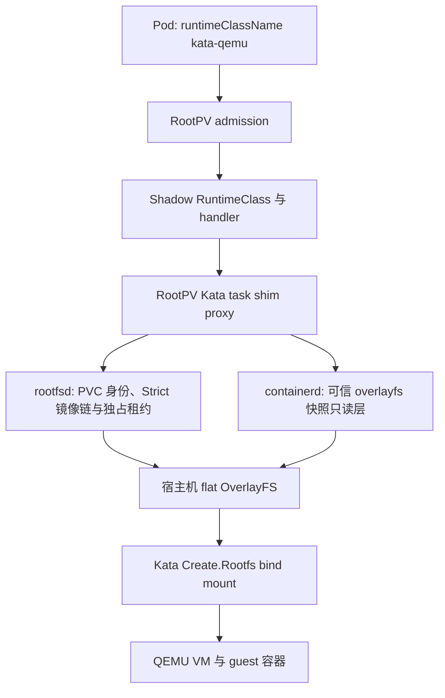

# Kata + QEMU task shim adapter

日期：2026-10-14。范围：containerd、Kata + QEMU、overlayfs 和 RootPV flat-lowerdirs。

## 问题与接入边界

现有 RootPV wrapper 实现 runc 的 OCI CLI 协议，而 Kata 的 runtime_path 指向长期运行的
containerd task shim。将 Kata shim 填入 BinaryName 无法截获工作负载容器 Create，
也无法正确处理一个 sandbox 内的多个容器。因此增加独立 task shim proxy，保留 runc 路径。

支持 io.containerd.kata-qemu.v2，以及明确配置 QEMU 的 io.containerd.kata.v2。
发现流程必须从源 handler 的 runtime_path 与 options.ConfigPath 得到可信路径；
不会猜测任意 shim 二进制。Kata TOML 仅包含 hypervisor.qemu，runtime.hypervisor_name
在非空时必须为 qemu。其他 hypervisor 和 task shim 继续失败关闭。

## 数据路径

源 handler 和导入文件保持不变。Shadow handler 保留 Kata ConfigPath、runtime_type、
设备选项、annotations、RuntimeClass overhead 和 scheduling；runtime_path 改为每个
adapter 的生成别名。别名指向单一 containerd-shim-rootpv-kata-v2。
节点 registry 保存真实 Kata binary 路径和节点摘要；集群 API 不发布这些路径。
Kata 摘要生成必须成功编码源 options 并读取完整配置；发现阶段失败报告 runtime_digest_unavailable，
reconcile 阶段失败返回错误，停止此次配置与 registry 写入。

Proxy StartShim 调用原 Kata start，完整转发 options stdin、namespace、id、address、
publish-binary 和 debug，再创建自己的 task socket。Sandbox 固定委托地址和 adapter
到 root 所有的 bundle 文件，registry 后续变更不会重新路由已有容器。

Kata Rust runtime 在 sandbox Create 前拒绝 Connect。因此代理先回应自身的就绪握手；
Unix socket 内核凭据只用于验证 root 监听者，不能将继承 listener 的短期启动 PID
用作存活 shim 身份。目标容器创建前，通过 sandbox 创建后的 Kata Connect 取得实际
shim PID/starttime。创建失败的启动清理使用 Kata 写入的 shim.pid，并核对可执行文件
和 starttime 后才能终止这个尚未接受 task Create 的特定进程。

## 写层生命周期

1. 从 OCI annotations 匹配已固定的 adapter。Sandbox 和未选中的 sidecar 直接转发 Create。
2. 从 containerd 快照元数据取得只读层并验证路径白名单、真实目录及空的 active upper。
3. rootfsd 验证实际 Pod/PVC/容器身份，使用 Strict image chain 元数据取得单写者租约。
4. 保存 rootpv-kata-shim-v1 状态，探测并挂载 flat OverlayFS。
5. MarkMounted、BeginCreate、RegisterDelegate 绑定 proxy 与实际 Kata shim 身份。
6. 将 Create.Rootfs 替换为 merged 的 bind mount，保留其他 task 字段与 Kata options。
7. Kata Create 成功后提交租约并保存 created 状态。
8. 删除时先 Kata Delete，再正常卸载 merged，确认挂载消失，最后释放租约和删除状态。

Create RPC 出错可能发生在实际创建之后，回滚必须先完成 Kata Delete 或确认 NotFound，
再卸载和释放。任一步无法确认则保留状态与锁。Exec process Delete 不释放容器租约。

Proxy 记录 sandbox 内的活动 task，在所有 task 删除前忽略 Shutdown，防止删除单个
sidecar 时关闭共享 shim。委托连接关闭时，proxy 退出，由 containerd 和 rootfsd 处理恢复。
rootfsd 重启恢复 flock；proxy 或 Kata shim 任一仍存活时保留租约。两者均退出后，
清理记录的 mount namespace 内的 merged；此路径不会把 Kata 当作 OCI CLI 运行。

## 验证与限制

单元测试覆盖 imported handler 发现、QEMU 类型限制、配置缺失、导入循环、原配置保持、
adapter 不匹配、sandbox/sidecar 路径、创建回滚、卸载失败、共享 shim Shutdown 和活跃 shim 租约保留。
CI 回归还覆盖空凭据、非 root peer、凭据检查后的连接与 deadline、摘要错误、分阶段创建回滚和代理终止错误。
集群验证覆盖 Pod 重建持久化、文件权限/链接、单写者互斥、rootfsd 重启、普通 Kata Pod 与删除清理。

Kata 使用和重建步骤见 [使用指南](../user-guide/kata-qemu.md)，功能证据见
[2026-10-14 验证记录](../../tests/e2e/results/kata-qemu-2026-10-14.md)，
完整清单见 [Kata 测试 YAML](../../tests/e2e/manifests/kata-qemu.yaml)。
此次没有验证节点重启、Kata shim OOM、QEMU 崩溃恢复、跨节点迁移、性能、GPU/设备或 checkpoint 恢复。
